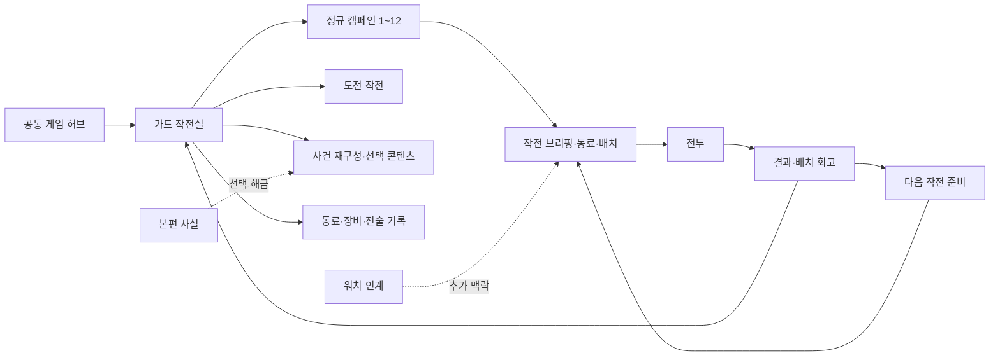
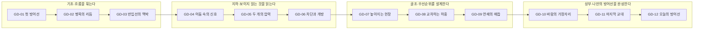

# SIGNAL GUARD — 독립 디펜스 캠페인 마스터 기획서

**가칭: 시그널 가드 — 오늘의 방어선**  
작성일: 2026-10-15 · 현재 저장소 기준: `020a070ff2cdaeab0d0f96e57b7ffa718bc7e439` · 디펜스 실행 기준: `5e54c5a65f172fe9b0938f034ee83be107bec482`  
상태: **기획 제안 / 런타임 미구현 / 명칭·신규 세계관·신규 능력은 최종 확정 전**

이 문서는 사용자가 요청한 ‘스토리의 보너스가 아닌 독립 디펜스’의 제작 명세다. 기존 [통합 종합기획](NEW-PSI-INTEGRATED-MASTER-PLAN-20261015.md)의 디펜스 확장안을 구체화하며, 당시의 ‘공개 준비중’ 표기는 현재 상태로 재사용하지 않는다. 최상위 [Master Design Principles](MASTER-DESIGN-PRINCIPLES.md), [현장 철학](../GAMEPLAY_DOCTRINE.md), 승인된 인물과 본편 사건을 보존한다. 이번 작업에서 게임 코드·저장·해금·가격을 변경하지 않는다.

## 1. 제안의 핵심

**플레이어가 완성하는 것은 포탑의 숫자가 아니라, 위험의 흐름을 끊는 하나의 방어선이다.**

워치는 직접 현장을 돌며 신호를 발견하는 즐거움, 브레이커는 움직이며 위험을 연쇄 해소하는 즐거움, 가드는 한 발 물러서서 자신이 설계한 배치가 작동하는 즐거움을 맡는다. 스토리를 읽지 않은 사람도 첫 작전부터 마지막 작전까지 진행할 수 있다. 다른 모드를 플레이한 사람에게는 같은 현장이 다르게 읽히는 연결을 제공한다.

추천하는 완성형은 **4개 공정 구역 × 3작전 = 정규 12스테이지**, 도전 변형, 장비별 전술 숙련, 캐릭터에 남는 작전 기록이다. 실제 제작은 **첫 구역 3스테이지의 완성된 단면**부터 시작한다. 12개 이름과 잠금만 먼저 늘리지 않는다.

플레이 후 남겨야 하는 감정은 세 가지다.

1. “내 배치 때문에 여기서 한꺼번에 정리됐다.” — 설계의 쾌감.
2. “같은 장비라도 이 위치와 분기가 다르면 완전히 달라진다.” — 재도전의 발견.
3. “이 동료와 이 현장을 내가 잘 안다.” — 캐릭터와 장소에 대한 애착.

## 2. 현재 상태 진단 — 무엇이 있고 무엇이 없는가

| 확인한 현재 사실 | 플레이어에게 남는 문제 | 이번 기획의 처방 |
|---|---|---|
| 공통 허브에서 `training-ramp-v1`로 직접 진입 가능 | 입구는 독립적이지만 계속 진행할 캠페인이 없음 | 전용 홈·공정 지도·다음 작전·챕터 결말 구성 |
| 시나리오 선택에는 기본 훈련과 경사로 재구성 이벤트가 있음 | ‘훈련/추가 이벤트’의 구조로 보임 | 정규 캠페인 / 도전 / 사건 재구성을 분리 |
| 재구성 E1은 기본 훈련 클리어와 본편 `ep01.ramp-signal-known`이 필요 | 추가 디펜스를 하려면 다른 모드가 필요하다고 느낄 수 있음 | 스토리 조건은 별도 사건 재구성에만 유지 |
| 1000×600, 8패드, 단일 경로, 10파의 기본판 | 맵을 다시 읽는 즐거움과 스테이지별 전술 차이가 적음 | 새 경로·패드 관계·편성·환경 전환으로 작전 구별 |
| 4장비와 실제 L3A/B 분기, 2지원이 이미 있음 | 좋은 기반을 캠페인 성장으로 경험하지 못함 | 전술을 배우는 순서와 다른 해법으로 재도전하는 구조 |
| 새 장비 16종·위험체 6종·배경 2종, 실제 표적 기반 발사/명중 연출 | 기본판에 집중돼 있어 새 구역까지 같은 수준인지 불명확 | 구역별 배경·전환·보스·배치 화면 제작 계약 마련 |
| 시나리오별 클리어·별·장식 보상·정산 중복 방지 저장 존재 | 캠페인 경로·분기 숙련·작전 재생 버전은 없음 | 기존 저장 보존 + 캠페인 진행 스키마의 명시적 추가 |
| 본편 복귀 중심의 명칭과 안내가 남음 | 독립 게임으로서의 정체성이 흐려짐 | ‘가드 작전실’과 ‘게임 허브’ 기준의 일관된 복귀 |

근거: `src/ui/GameHub.tsx`, `src/ui/DefenseGame.tsx`, `src/app/defense-story-bridge.ts`, `src/domain/defense-save.ts`, `content/defense/{zero-breach-v1,events-v1}.json`. 별도 현장/공법 콘텐츠와 엔진이 존재하는 것과 일반 사용자가 정규 캠페인으로 접근 가능한 것은 구분한다. 현재 전체 디펜스가 스토리에 잠겨 있다는 진단은 정확하지 않다. **독립적인 연속 경험이 없는 것이 핵심 결함**이다.

## 3. 세계관 — 같은 사건을 세 가지 거리에서 본다

### 3.1 연결 제안

가드의 무대는 **‘현장 대응실의 전술 재구성’**으로 제안한다. 현장의 사람·제보·물류·환경 변화에서 남은 기록을 축약해 위험의 전파를 시뮬레이션한다. 플레이어는 현장 동료 한 명을 작전 파트너로 선택하고 배치를 설계한다. 이는 새로운 통합 서사 제안이며, 기존 모든 콘텐츠가 이미 이 설정으로 확정됐다는 뜻은 아니다.

| 모드 | 같은 현장을 바라보는 질문 | 고유한 행동 | 다른 모드에 남기는 것 |
|---|---|---|---|
| 시그널 워치 | 어디에서 이상 징후가 보이는가? | 이동·확인·계도·인계 | 관측 기록, 인물과 장소의 맥락 |
| 시그널 브레이커 | 위험이 몰릴 때 어떻게 흐름을 뚫는가? | 이동·발사·진화·연쇄 해소 | 장비 문법에 대한 친숙함, 대응 훈련 기록 |
| 시그널 가드 | 어느 지점에 무엇을 두면 연쇄를 끊는가? | 배치·분기·우선순위·지원 타이밍 | 방어선 도면, 작전별 판단의 흔적 |
| 스토리 | 왜 이 신호가 묻혔고 누가 무엇을 판단했는가? | 증언·근거 비교·선택·책임 | 사건의 원인과 후속 관계 |

각 모드는 단독으로 끝까지 즐길 수 있어야 한다. 워치 기록이 없으면 가드는 자체 브리핑을 제공한다. 기록이 있으면 같은 브리핑에 출처와 동료의 한 줄 해석을 더한다. 필수 장비·통화·작전 입장권을 다른 모드에서 얻도록 만들지 않는다.

### 3.2 독립 서사의 주제

가드의 짧은 이야기는 **“완벽한 장비 하나보다, 서로 연결된 대응이 현장을 지킨다”**이다. 처음에는 눈앞의 빠른 신호를 쫓는다. 중반에는 가려진 신호와 동시 압력을 이해한다. 마지막에는 자신의 방식으로 현장 전체의 흐름을 읽는다.

동료가 강의로 정답을 말하는 대신, 작전 전 1~2문장으로 관점을 제시한다. 작전 후에는 실제 플레이와 관련된 한 줄을 남긴다. 실패해도 인물의 죽음이나 실제 사고를 자극적으로 소비하지 않는다. 전술 재구성 실패로 기록하고 재설계를 제안한다.

| 구역 | 짧은 서사 갈등 | 클리어 뒤 남는 변화 | 대사 톤 초안 |
|---|---|---|---|
| 기초 | 눈앞의 신호를 빨리 정리하려다 다음 흐름을 놓침 | 입구 하나가 아니라 동선 전체를 바라보기 시작 | 강태식: “앞에서 끝낼지, 굽이에서 모을지. 이번엔 네 배치를 보자.” |
| 지하 | 각자의 위치에서는 다른 신호만 보여 판단이 엇갈림 | 확인되지 않은 부분을 표시하고 서로의 시야를 연결 | 임준호: “안 보이던 쪽이 열리니까, 앞에서 본 것도 다르게 보여요.” |
| 기준층 | 한 구역의 빠른 처리가 다른 구역의 압력과 맞물림 | 국소 효율보다 인계와 시간차를 설계 | 강태식: “여기만 잘 막아서는 안 끝나네. 다음 구간까지 이어보자.” |
| 상부 | 익숙한 배치를 그대로 반복할지 바뀐 흐름을 읽을지 선택 | 동료와 함께 만든 최종 도면과 하루의 기록이 남음 | 임준호: “처음엔 들어오는 것만 봤는데, 이제 어디서 만나게 할지가 보여요.” |

대사는 톤 검토용 신규 초안이다. 승인된 본편 대사를 대체하지 않는다. 작전 기록에 없는 인계/성공을 대사로 만들어내지 않고, 실패와 다른 배치에도 맞는 분기 문장을 작성한다. 최종 결말은 ‘안전이 영구 완성됐다’가 아니라 **오늘의 기록을 다음 판단에 넘기는 것**으로 닫는다.

### 3.3 지킬 경계

- 위험체는 실제 사람/근로자가 아니다. 물체·설비·에너지·정보 단절의 시뮬레이션 표상이다.
- 브레이커식 빛·연쇄 효과는 훈련 표상 안에서 강화한다. 현실의 분진·하중·전기 위험을 광선으로 없애는 장비 설명을 하지 않는다.
- 가드 클리어로 본편의 조사 사실, 실제 안전 승인, PSI 공식·점수를 새로 만들지 않는다.
- 공정이 성장하는 캠페인 지도는 가드의 진행이다. 본편 공사 일정이 자동으로 몇 달 진행된 것으로 해석하지 않는다.
- 기존 E1의 본편 사실 조건은 보존한다. E1을 정규 캠페인 필수 관문으로 사용하지 않는다.

## 4. 독립 진입과 화면 구조



**최초 진입:** 짧은 타이틀 → 1-1 카드에 ‘첫 방어선 시작’ → 동료 선택 → 추천 첫 배치. 계정 생성·스토리 완료·긴 세계관 설명을 요구하지 않는다.

**재진입:** 작전실에서 마지막 동료와 현재 공정 구역을 보여준다. 가장 큰 버튼은 유효한 중단 기록이 있으면 ‘작전 이어하기’, 없으면 ‘다음 작전 1-2’처럼 구체적으로 표시한다. 도전/기록/사건 재구성은 보조 메뉴다.

**뒤로 가기 계약:** 전투 중 게임 허브로 나가면 저장 확인 후 허브로, 작전실로 나가면 저장 후 작전실로 간다. 결과→다음 준비에서도 작전 지도/작전실/게임 허브로 돌아갈 수 있다. 선택창을 닫는 것과 전투 재개를 구분한다. 복귀 위치는 명시적 `origin`으로 관리하고 다른 모드의 마지막 세이브를 추측해 열지 않는다.

**현재 기본 훈련의 위치:** 기존 10파는 ‘연습장: 경사로 표준 훈련’으로 보존한다. 정규 1-1을 기존 10파와 동일한 콘텐츠로 이름만 바꾸지 않는다. 기존 클리어 유저에게 첫 안내 건너뛰기와 기록/기념 장식을 제공할 수 있지만, 새로운 12개 작전의 클리어를 임의로 지급하지 않는다.

## 5. 전투의 대표 경험 — 방어선의 리듬

### 5.1 한 작전의 5박자

| 박자 | 플레이 경험 | 제작 지시 |
|---|---|---|
| 읽기 | 어디에서 어떤 신호가 들어오는지 파악 | 실제 경로·형상·다음 편성을 짧게 표시. 은폐도 ‘미확인 신호 예정’으로 경고 |
| 설계 | 내 방식의 첫 대응을 선택 | 추천 한 곳과 대안 한 가지. 둘 다 실제 비용과 범위 표시 |
| 압력 | 빠른/밀집/장갑 흐름이 교차 | 물량·간격·위치로 압박. 내구도만 키우지 않음 |
| 전환 | 중간 공정 변화로 기존 배치를 다시 해석 | 전환 전에 명확히 예고하고 준비 시간을 제공. 허용된 변화만 발생 |
| 해소 | 모은 신호가 계획한 지점에서 연쇄 정리 | 실제 다수 피격·해소와 빛/소리를 동기화. 가짜 추가 처치 표시 금지 |

상시 선택 팝업은 넣지 않는다. 고민은 파 사이 또는 플레이어가 배치를 열어 정지한 때에 집중시킨다. 전투 중에는 결과가 자연스럽게 보이게 한다. 1배속 기준 첫 클리어 4~9분을 목표로 하되 최종 시간은 실측으로 조정한다.

### 5.2 고유 장치 ① ‘집중 구간’ — 현재 엔진으로 먼저 구현

맵에는 넓게 대응하는 지점, 핵심 위험을 오래 보는 지점, 후방 누출을 잡는 지점이 있어야 한다. 다수 위험이 같은 구간에 들어올 때 CONTROL로 간격을 묶고 BURST로 해소하거나, PULSE 두 곳으로 앞뒤를 나누거나, SENSOR의 순수 피해 분기로 장갑 핵심을 먼저 줄이는 등 **적어도 세 가지 방어선**이 성립하도록 만든다.

장비 사이에 연결선만 그려 숨은 추가 피해를 주지 않는다. 초기판의 조합 쾌감은 기존 사거리·감속·대상 우선순위·탐지·분기 성능에서 나온다. 결과 회고에서 ‘P2 감속 구간에 6개 밀집 → P4 분산기 동시 해소’처럼 검증 가능한 사실을 보여준다. 엔진에 기여 기록이 없다면 추측한 인과를 숫자로 단정하지 않고 ‘해소 집중 구간’만 보여준다.

### 5.3 고유 장치 ② ‘현장 전환’ — 신규 규칙의 핵심

각 구역의 세 번째 작전에는 **예고된 현장 전환**을 둔다. 예: 조명 구역 변경, 반입 흐름 변경, 새로운 하부 통로 개방. 배경·편성·배치 판단이 함께 변해야 한다. 날씨 필터만 얹은 전환은 불충분하다.

전환은 고정 파 사이에서 발생한다. 전환 준비 화면에서 새 흐름과 영향을 보여주고 사용자가 ‘전환 후 작전 시작’을 누른다. 유료 재화나 광고 없이 한 번의 재배치 검토를 제공한다. 영구 지형/경로 변경, 장비 이동 명령, 매각 환급 규칙의 변경은 엔진에 명시하며 UI 좌표만 옮기지 않는다.

**첫 3작전 단면에서는 단일 경로를 유지**하고 편성·조명·해소 연출만 바꾸는 축소형 전환을 검증한다. 복수 경로/경로 전환은 다음 단계다. 현재 엔진이 단일 `map.path`를 쓰기 때문에 이미 가능한 기능으로 표시하지 않는다.

### 5.4 고유 장치 ③ ‘연쇄 매듭’ — 후반부의 목표 전환

후반 보스는 큰 HP 덩어리 대신 위험 흐름을 묶는 비인간 ‘매듭’으로 제안한다. **결집 예고 → 보조 신호 공급 → 노출 창 → 해소**의 네 단계가 외형과 소리로 읽힌다.

새 단계 효과는 별도 엔진 명세로 구현한다. 보조 신호의 개수·출처·노출 창을 고정 예고하며 은폐된 필수 약점을 갑자기 요구하지 않는다. 탐지로 창을 넓히거나, 제어로 공급 간격을 벌리거나, 단일 대응으로 핵심을 먼저 제거하는 해법을 남긴다. 특정 동료·한 장비만 정답이면 재설계한다. 기존 BOSS의 HP60% 장갑 전환을 이 4단계 기능으로 이미 구현했다고 부르지 않는다.

## 6. 정규 12작전 설계

아래 파 수/시간은 **기획 목표**, 편성·예산·난도는 밸런스 검증 전이다. 최소 하나의 다른 배치 판단과 화면 변화가 없는 스테이지는 추가하지 않는다. 정규 진행은 앞 작전 **1회 클리어**로 다음 작전이 열린다. 3별·스토리·다른 모드·광고·반복 재료는 요구하지 않는다.

| ID / 작전명 | 공정·공간 | 파 / 시간 목표 | 플레이의 새 질문 | 대표 편성·전환 | 시각적 보상 |
|---|---|---|---|---|---|
| GD-01 첫 방어선 | 기초·반입 경사로 | 6 / 4~5분 | 입구 가까이 둘까, 오래 보는 지점에 둘까? | NORMAL→SWIFT→SWARM, 강제 보스 없음 | 어두운 현장 진입부에 유도선과 작업등이 켜짐 |
| GD-02 병목의 리듬 | 기초·적치장 외곽 굽이 | 7 / 4~6분 | 밀집을 앞에서 풀까, 모아 한 번에 해소할까? | 빠른 묶음 뒤 군집, 약한 장갑 첫 예고 | 적치 동선이 정돈되고 다음 구역 접근로가 드러남 |
| GD-03 반입선의 맥박 | 기초·교차 반입 구역 | 8 / 5~7분 | 동시 압력 속 우선순위를 언제 바꿀까? | 단일 경로 2연속 압력, 기존 장갑 보스 변주부터 검증 | 첫 구역 전체의 조명·운영 흐름 복구 |
| GD-04 어둠 속의 신호 | 지하·저층 시야 구간 | 7 / 5~6분 | 불확실한 곳을 먼저 밝힐까, 화력을 늘릴까? | VEILED 예고, 밝은 구간과 가려진 구간 대비 | 조명 회로가 순차적으로 현장 깊이를 드러냄 |
| GD-05 두 개의 압력 | 지하·물류 동선 분리 | 8 / 5~7분 | 두 흐름에 균등 배치할까, 합류점에 집중할까? | 2경로 최초 도입, 한쪽 군집/다른 쪽 장갑 | 상하 깊이가 읽히는 지하 작업층 개방 |
| GD-06 차단과 개방 | 지하·통로 교대 | 9 / 6~8분 | 전반 배치가 후반에도 유효한가? | 파 사이 한 번 통로 전환, 재배치 검토 | 통로의 닫힘/개방이 배경과 경로에 함께 반영 |
| GD-07 높아지는 현장 | 기준층·양중 주변 | 8 / 5~7분 | 긴 외곽로와 짧은 통과로 중 어디를 맡길까? | 긴 우회 신호와 빠른 직행 신호 | 지상에서 골조로 올라온 높이감과 원경 |
| GD-08 교차하는 하중 | 기준층·합류 구역 | 9 / 6~8분 | 장갑 핵심과 군집 중 무엇을 먼저 줄일까? | 다방향 시간차 합류, 긴 사거리 분기 기회 | 대응에 따라 구역별 경보가 질서 있게 해제 |
| GD-09 연쇄의 매듭 | 기준층·집중 대응 | 10 / 6~9분 | 공급을 늦출까, 핵심 노출 창에 집중할까? | ‘연쇄 매듭’ 첫 완성형, 공급 묶음 예고 | 보스 장갑/접속 링의 단계별 실제 분리 |
| GD-10 바람의 가장자리 | 상부·외곽 작업층 | 8 / 5~7분 | 예고된 환경 변화에 어느 구간을 남길까? | 환경 창에 편성/진입 간격 변화. 실제 발사체 빗나감은 도입하지 않음 | 바람·차폐막·원경과 대응층이 구별됨 |
| GD-11 마지막 교대 | 상부·연속 인계 | 10 / 6~9분 | 하나의 만능 배치 대신 언제 전술을 바꿀까? | 군집→은폐→핵심 압력, 안정된 휴지 구간 | 동료와 장비의 작전 흔적이 최종 구역에 누적 |
| GD-12 오늘의 방어선 | 상부·최종 통합 재구성 | 12 / 7~9분 | 지금까지 만든 내 방어선이 완성됐는가? | 2회 예고 전환, 복합 매듭, 낮은 체력의 해소 구간 포함 | 현장 전경의 경보가 가라앉고 다음 날의 조명으로 마감 |

구역명과 공정 연결은 신규 캠페인 제안이다. 실제 공법의 안전성/작업 절차를 이 표로 일반화하지 않는다. 별도 콘텐츠 목록은 [스테이지 카탈로그](planning/defense-independent-campaign-v1.json)에 같은 ID로 보존한다.



### 6.1 반복을 줄이는 작전 차이 계약

인접한 두 작전은 **경로 관계·패드 관계·주력 위험의 시간 패턴·전환 목표·화면 실루엣** 중 최소 두 항목이 달라야 한다. 같은 맵에서 HP와 출현 수만 올린 작전은 정규 스테이지로 세지 않는다. 단, 첫 구역은 하나의 현장을 배우는 장소이므로 배경 재사용을 허용하되 실제 공간 관계와 플레이 질문이 달라야 한다.

GD-01~03은 현재 단일 경로 엔진으로 제작할 수 있는 다른 정적 맵이다. GD-05 이후의 복수 경로 등은 엔진 확장 전에는 ‘미구현’으로 남긴다. 단일 지도에 길 두 개를 그린 이미지만 먼저 넣지 않는다.

## 7. 첫 구역을 실제로 만들 수 있는 세부 명세

### 7.1 GD-01의 첫 90초

| 시점 목표 | 화면과 행동 | 성공 기준 |
|---|---|---|
| 0~10초 | 현장 전체·입구·보호 지점. 두 동료의 이름/능력 중 추천 선택 | 첫 플레이어가 메뉴를 되돌아가지 않고 출전 가능 |
| 10~25초 | ‘이 굽이에서 오래 대응할 수 있습니다’ 한 줄, 추천 패드 점등 | 추천 확인→장비 구매 두 단계. 대안 선택 가능 |
| 25~45초 | 정상 흐름 첫 등장, 실제 발사·명중·해소를 짧게 경험 | 첫 적 전에 튜토리얼 카드가 전투 중앙을 덮지 않음 |
| 45~65초 | 한 번에 몰리는 신호 예고, 범위 대응 추천 | 현재 비용으로 가능한 선택만 추천 |
| 65~90초 | 작은 밀집이 정리되는 첫 해소 장면, 지원 사용 기회 | 가짜 처치·자동 승리 없이 플레이어 배치의 효과가 보임 |

시간은 사용자 조작을 포함한 목표다. 준비 중 시간을 재촉하지 않는다. 읽기가 느려도 파가 자동 시작되지 않는다. 첫 지원을 쓰지 않았다는 이유로 실패하게 만들지 않는다.

### 7.2 GD-01 6파 편성 브리프

1. NORMAL의 간격 있는 흐름: 첫 장비의 사거리와 타격을 읽는다.
2. NORMAL 두 묶음: 한 패드가 처리하는 시간과 후방 여유를 비교한다.
3. 짧은 SWIFT 흐름: 제어 또는 앞뒤 배치가 도움이 되는 이유를 본다.
4. SWARM 밀집: BURST의 범위 해소가 시각·사운드로 보상된다.
5. NORMAL+SWIFT 시간차: 두 장비의 역할 분담을 만든다.
6. SWARM의 풍성한 해소 후 소수 핵심: 첫 마무리는 장갑 체력벽 대신 ‘내 설계가 작동했다’로 끝낸다.

정확한 개체 수·간격·초기 예산은 시뮬레이션에서 결정한다. 초기 방호20 및 기존 장비 가격을 기준으로 출발하되, GD-01은 새 전용 편성/콘텐츠 ID를 사용한다. 기존 표준 훈련의 151개를 이름만 바꿔 재사용하지 않는다.

### 7.3 GD-02와 GD-03의 검증할 차이

GD-02는 첫 굽이 뒤 넓은 대응 구간을 둬 ‘모아 해소’와 ‘앞뒤 분담’을 비교한다. GD-03은 짧은 압력 뒤 긴 압력을 넣어 즉시 지원과 보존의 선택을 만든다. 위험이 적어 정적인 시간이 길어지면 우선 간격·묶음을 조정한다. 내구도를 올리는 것으로 체류 시간을 채우지 않는다.

3개 모두 추천 기본 배치, 단일 대응 중심, 범위/제어 중심의 최소 세 배치군으로 정상 구매·지원만 사용해 검증한다. 플레이어 조작 없이 추천 봇이 이겼다는 사실을 사람의 재미나 난도 적절성으로 대신하지 않는다.

## 8. 성장 — 더 센 수치보다 더 나다운 방어선

### 8.1 세 가지 성장 축

| 축 | 한 작전 안 | 작전 사이 | 피해야 할 구조 |
|---|---|---|---|
| 장비 | L1→L2→L3A/B, 실제 예산 사용 | 분기 숙련·전술 설명·장비 외장·도면 저장 | 반복 노가다로 공격력 수백% 상승 |
| 동료 | 실제 지원 능력과 타이밍 | 작전 기억·선호 전술·초상/대사/장식 | 호감도 때문에 사실이 참이 되거나 필수 과금 영웅 등장 |
| 플레이어 | 위치·우선순위·예산 판단 | 내 도면 비교·새 구역·도전 규칙 | 다른 모드 통화나 출석으로 정규 작전 입장 제한 |

기본 4장비는 초반부터 사용할 수 있게 한다. 초보 추천이 선택지를 단계적으로 안내하되, 잠금으로 정상적인 대응 수단을 빼앗지 않는다. L3 분기는 작전 중 자원으로 선택한다. 영구 숙련이 기존 전투 가격을 몰래 낮추지 않는다.

### 8.2 캐릭터 애착

첫 제작은 현재 실제 구현된 **강태식(COORDINATOR), 임준호(OBSERVER)** 두 명이다. 강태식의 역할·임준호의 신입 근로자 설정과 승인된 순찰 요원 초상/전신을 유지한다. 임준호를 군사 정찰병 등 다른 직업으로 재설정하지 않는다. 그의 관측 지원은 재구성에서 다른 관점으로 신호를 확인하는 역할이다.

현 지원 기준: 강태식 흐름 정리 3초/재사용45초, 임준호 전체 확인8초·사거리+30/재사용40초. 이는 현재 게임 수치다. 독립 캠페인 밸런스 변경 시 명시적 표로 버전 관리한다.

애착은 능력 숫자보다 **그 동료와 만든 방어선의 기억**에서 시작한다. 예: 첫 무누출 작전의 도면에 동료 서명, 지원 직후 실제 해소가 집중된 구간의 짧은 회고, 챕터 종료 후 2~3줄 대화. 판단/발언 조건을 실제 기록에서 가져오고 발생하지 않은 활약을 칭찬하지 않는다.

후속 ‘동료 전술 갈래’는 한 번에 한 갈래만 선택하는 수평 특화로 제안한다. 강태식은 긴 국소 정리/넓은 짧은 정리, 임준호는 오래 읽기/짧고 넓게 확인하기처럼 이득과 포기가 함께 있어야 한다. **새 능력과 수치는 미확정이며 첫 3작전의 필수 제작 범위에서 제외**한다. 현재 매핑만 존재하는 COMMANDER/REBAR_LEAD/ENGINEER를 완성된 선택 캐릭터로 홍보하지 않는다.

### 8.3 도면과 회고

‘내 방어선’에는 패드별 장비·분기·표적 우선순위와 해당 콘텐츠 버전을 저장한다. 도면 불러오기는 계획 미리보기다. 비용을 생략해 배치를 무료 복원하지 않는다. 초기 예산으로 살 수 있는 단계까지만 순서대로 적용하고 차액/불가 항목을 알려준다. 실행 전 확인, 되돌리기, 빈 계획으로 시작을 제공한다.

도면 비교는 같은 작전/난도/콘텐츠 버전에서만 나란히 보여준다. 다른 버전의 최고 점수를 같은 조건의 기록처럼 비교하지 않는다. 온라인 랭킹·서버·클라우드 동기화를 첫 출시 전제로 두지 않는다.

## 9. 물량·난도·반복 도전

### 9.1 체력벽 대신 파동의 밀도

정규 중후반의 초기 목표는 화면 내 활성 위험체 **18~32개**, 짧은 절정 **36~48개**다. 이는 아직 성능·밸런스 검증 전인 제작 목표다. 낮은 내구도의 다수 신호, 소수 장갑 핵심, 빠른 선두, 은폐 후속을 섞는다. 모두 장갑으로 바꾸거나 동일 패턴의 수만 늘리지 않는다.

48개 규칙은 모든 기기에서 같아야 한다. 기기가 느리다고 적을 줄여 클리어와 보상을 다르게 만들지 않는다. 성능 옵션은 입자·잔광·그림자·음성 수를 조절한다. 엔진의 출현 규칙을 바꿀 필요가 있으면 기기별 임시 처리가 아니라 전 기기 공통 콘텐츠 수정으로 검증한다.

‘해소 휴지’는 아무것도 없는 대기 시간이 아니다. 직전의 빛이 잦아들고 동료의 짧은 반응/다음 흐름 예고가 들어오는 3~6초 목표의 호흡이다. 준비 화면은 사용자가 필요한 만큼 정지할 수 있다.

### 9.2 난도와 도전

- **정규:** 1회 클리어로 다음 작전. 시작 추천과 모든 예고 제공. 캠페인 완주가 기본 제품이다.
- **도전:** 해당 정규 작전 완료 후 선택. 한 번에 하나의 규칙을 바꾼다. 예: 설치 지점 일부를 사전 지정한 ‘좁은 방어선’, 예산을 제한한 ‘정밀 설계’, 밀집 간격을 바꾼 ‘과밀 대응’. 이미 시작한 뒤 규칙을 바꾸지 않는다.
- **자유 재구성:** 이미 해금한 장비/맵으로 도면 시험. 정규 기록과 구분한다. 입장 재화·패배 벌금 없음.
- **휴식형 무한 방어선:** 별도 후속안. 브레이커 잔광과 역할 중복을 먼저 검토한다. 첫 출시 범위를 늘리는 필수 기능으로 넣지 않는다.

별 평가는 제안상 1별 클리어, 2별 방호75% 이상, 3별 무누출이다. 모든 정규 작전의 초기 방호20을 유지한다면 75%=15로 현재 기준과 맞출 수 있다. 방호가 달라지는 콘텐츠에서는 고정20 비교를 재사용하지 않는다. 속도·읽기 시간·추천 사용은 별을 깎지 않는다. 별은 다음 작전의 강제 관문이 아니다.

## 10. 그래픽 고도화 — 한 장의 멋진 배경에서 살아 있는 현장으로

### 10.1 화면의 주인공

작전실은 훈련 카드 목록이 아니라 **현재 구역의 살아 있는 현장 전경**이다. 카메라 전면에는 선택한 동료, 중경에는 현재 방어선의 장비, 원경에는 공정이 성장한 현장이 보인다. 가장 큰 액션은 하나만 둔다. 로그/수치/전체 도감을 첫 화면에 펼치지 않는다.

공정 지도는 구역별 현장 실루엣을 잇는 공간이다. 첫 구역 완료 후 같은 현장 전경에 지하 구조가 보이고, 이후 골조·상부가 자란다. 진행을 모르는 검은 잠금 카드 12개로 채우지 않는다. 다음 구역은 실루엣과 한 줄 예고만 보여준다.

### 10.2 아트의 기준과 금지

현재 `public/assets/defense/premium-v1/`의 장비 재질과 세부 묘사, 실제 표적 기반 전투 연출을 최소 연결 기준으로 삼는다. 단, 현재 dusk 한 장을 모든 시간·공정에 복제하지 않는다. 기초의 따뜻한 작업등, 지하의 국소 작업광, 골조의 자연광과 높이감, 상부의 차가운 원경으로 구역을 구분한다.

본편 Episode01의 승인된 카메라를 이 문서로 바꾸지 않는다. 가드는 현재 디펜스의 높은 시점과 읽기 쉬운 장비 실루엣을 보존하고, 구역 간 투시·조명·접지 비율을 일관되게 제작한다. 캐릭터는 WATCH→순찰 요원의 승인 초상/전신을 참조한다. 새 생성으로 얼굴을 다시 만들지 않는다.

실제 도로·난간·장비와 시뮬레이션 경로 오버레이를 분리한다. 경로선, 소켓, 문구, UI를 배경 원화에 굽지 않는다. 현장 입구·출구·패드·위험 흐름의 가독성이 장식보다 우선한다. 배경 속 작업자에게 발사체가 맞는 구도를 만들지 않는다.

### 10.3 제작 자산 패키지

| 묶음 | 최소 완성 단면: GD-01~03 | 12작전 확장 목표 | 수용 기준 |
|---|---|---|---|
| 구역 키아트 | 1구역 완성 원화와 완료 변형 | 4구역 각 1세트 | 각자 공간/공정이 다르고 UI 텍스트 없음 |
| 플레이 전투판 | 3개의 실제 경로/패드 관계를 지원하는 완성 배경 | 스테이지 공간 검증 후 산정, 최대 12판 기준 예산 | 배경과 판정의 입구/출구/패드가 일치 |
| 전환 오버레이 | 작업등·경보·정돈의 3상태 | 지하 개방/골조/상부 전환 | 다른 상태에서도 동일 구조물의 위치가 유지 |
| 장비 | 현재 16종 최종 후보 유지·접지/방출 위치 교정 | 새 계열을 수로 늘리지 않고 분기 가독성 보강 | 설치·도감·트리·결과의 동일 자산 연결 |
| 위험체 | 현재 6종, 작은 화면의 형상·장갑/은폐 상태 보강 | 매듭 보스 3단계 이상 실제 분해/노출 상태 | 서로 다른 형상, 피해 대상/위치와 일치 |
| 인물 | 강태식·임준호 정식 2명, 반응 연출 | 추가 인물은 능력/서사 별도 확정 후 | 얼굴·이름·역할·PPE 일치 |
| 결과 | 실제 배치 축소도 + 구역 정돈 연출 | 구역별 결말 장면 4종 | 장식 배지가 실제 결과를 가리지 않음 |

‘3상태’는 원본 3장을 무조건 별도 생성한다는 뜻이 아니다. 구조가 고정된 배경과 승인된 상태 레이어를 합성해 일관성을 지킨다. 등록 오차가 큰 별도 AI 원화는 경로 전환 장면으로 사용하지 않는다. 원본·참조·프롬프트·파생 좌표·해시·최종 후보 상태를 기록한다. 아틀라스 등분으로 안테나/부속을 자르지 않는다.

방향별 납품량도 예산에 포함한다. 첫 3판은 가로·세로 등록이 맞는 최소 6개 런타임 배경, 12판은 최대 24개를 기준으로 산정한다. 같은 지형의 방향별 파생본을 새 스테이지 수로 세지 않는다. 현재 작전·현재 방향의 필수 이미지와 음원만 먼저 로드하고, 전체 캠페인의 고해상도 자산을 첫 진입에 한꺼번에 받지 않는다. 구역 선택 썸네일은 별도 경량 파생본을 쓰며, 다음 작전 예열과 최대 2~3판 디코딩 캐시를 목표로 실제 메모리를 측정한다.

### 10.4 살아 있는 듯 보이게 하는 우선순위

먼저 장비의 실제 발사 방향·접촉점·동시 해소를 맞춘다. 다음으로 작업등, 차폐막, 경보의 국소 반응을 넣는다. 마지막으로 먼 크레인/원경 움직임을 제한적으로 넣는다. 전투판 전체가 항상 움직여 판단을 방해하지 않게 한다. 짧은 승리 여운은 허용하되 강제 영화 재생으로 다음 작전을 막지 않는다.

## 11. 모바일·PC UX를 캠페인 설계에 포함한다

### 11.1 세로 모드

현재 가로 비율 전투판을 세로 화면 가운데 축소하면 위아래 빈 공간이 커진다. 정규 캠페인의 새 맵은 **세로에서도 읽히는 구도**를 제작 요구에 넣는다. 목표는 안전 영역을 제외한 화면의 약65~75%를 전장/상호작용 공간으로 쓰는 것이다. 목표 비율 때문에 실제 경로나 출구를 자르지 않는다.

새 맵의 기본 해법은 **같은 월드를 90도 회전한 균일 투영**이다. 원본 월드 `(x,y)`와 높이 `H`에 대해 화면 기준 `(H-y,x)`로 변환하고 터치는 정확한 역변환을 쓴다. 사거리·속도·면적은 그대로 보존한다. 세로 전용 원화/상태 레이어도 이 등록 좌표에 맞춰 제작한다. 장비·인물의 읽기 방향과 광원은 별도 검수한다. 단순히 비율을 찌그러뜨리거나 세로 전용 적 위치를 만드는 방식은 사용하지 않는다.

첫 단면에서 이 투영의 미술/입력 검수가 통과하지 못하면 기존 지도와 명시적인 전체/확대 보기로 출시를 보류 판단한다. 검증 없이 회전 UI만 적용하지 않는다. 전투 중 화면 중앙 팝업·설명 문단·고정 ‘새 작전’ 버튼은 넣지 않는다. 동료 지원과 정지는 손가락이 닿는 하단 여유 영역에 둔다.

### 11.2 가로와 PC

가로 모바일은 전장 중심, 정보는 얇은 상단 띠와 접히는 측면 패널로 둔다. PC는 전장과 장비 비교를 함께 보여줄 수 있지만 모바일과 같은 판정/저장/예산을 사용한다. 패드 최소 터치 영역 44 CSS px를 목표로 하되 인접 패드가 겹치면 확대 선택과 목록 대안을 제공한다. 터치가 쉬워졌다는 이유로 실제 장비 사거리를 늘리지 않는다.

### 11.3 가벼운 이용자와 숙련자

초보자는 ‘추천 선택 → 비용 확인 → 배치 확정’만으로 따라갈 수 있다. 추천 이유는 ‘곧 군집 진입 / 현재 자원 / 이 굽이의 대응 시간’처럼 한 줄이다. 추천은 실제 가능한 다음 명령만 가리키며 장기 최적해인 척하지 않는다. 숙련자는 추천을 접고 직접 고른다.

‘다음 파 자동 시작’은 선택 설정으로 제안하되 기본값 OFF다. 분기/배치/동료 설명을 열면 항상 정지한다. 색 구분 외에도 형상·패턴·한글 이름을 쓴다. 움직임 줄이기·음소거·1배속에서도 공략 정보가 동일해야 한다.

## 12. 사운드·타격감의 캠페인 확장

현재 [전투 시청각 기획](DEFENSE-COMBAT-AV-PLAN-20261015.md)의 4계열 샘플 믹스와 8보이스 제한을 출발점으로 한다. 방출/명중은 엔진 프레임에 연결하고, 진화 모습과 소리의 두께가 함께 달라지게 한다. 새 음악이나 음원을 이미 제작했다고 표시하지 않는다.

| 층 | 공통 원칙 | 구역별 개성 |
|---|---|---|
| 현장 환경 | 작게, 루프 이음매 없이, 경보를 가리지 않음 | 기초의 넓은 외기 / 지하의 짧은 반사 / 골조의 열린 잔향 / 상부의 바람 |
| 음악 | 준비·압력·해소의 강약. 상시 최대 긴장 금지 | 구역별 음색이 달라도 같은 짧은 주제의 변주 |
| 장비 | 펄스의 선명함, 분산의 저중역, 제어의 체결, 관측의 정밀함 | 새 구역에서도 장비 정체성을 유지 |
| 위험/전환 | 음 없이도 형상으로 읽히고, 화면을 안 봐도 변화의 예고는 들림 | 매듭의 결집·노출·해소 모티프 |
| 인물 | 자동 장문 무전 금지, 핵심 경보가 우선 | 작전 전/전환/종료의 짧은 반응 |

군집 30개 해소 시 효과음 30개를 겹치지 않는다. 공간·시간상 가까운 실제 해소를 묶어 하나의 풍성한 소리로 표현하고 시각 피격은 실제 결과를 따른다. 목소리/핵심 경보가 재생될 때 음악·군집음을 낮추는 우선순위 버스를 후속 구현한다. 기존 G8A의 전용 믹스를 통째로 일반판에 복사하지 않는다.

새 음원의 납품에는 생성/녹음 서비스·사용 요금제·입력 자료·사용 조건·원본 파일을 기록한다. 무료 서비스로 만들었다는 사실만으로 유료 출시/광고 이용 가능을 확정하지 않는다. 내장 합성음을 ‘최종 녹음음원’으로 부르지 않는다. 실제 기기 스피커와 이어폰으로 피로도·명중 구별·음소거 후 잔향을 확인한다.

## 13. 보상과 제품 가치

최초 클리어의 핵심 보상은 다음 작전·새 현장·구역 변화다. 3별은 배지와 도면 표시, 분기 숙련은 외장·전술 기록으로 보상한다. 반복 플레이의 목적은 더 나은 방어선과 다른 동료 경험이지 재료를 모아 수치 문턱을 넘는 것이 아니다.

유료/무료+광고 방식은 미정이므로 캠페인 콘텐츠와 결제 시스템을 분리한다. 정규 12작전을 끝낼 수 있는 게임성과 품질을 먼저 만든다. 유료 패키지를 택하면 구역/동료를 추가 결제로 다시 막지 않는 방향을 추천한다. 광고를 택하면 전투·재시도·필수 해금에 강제 삽입하지 않는 설계를 우선 검토한다. 실제 결제/광고 SDK·가격·정책은 이 문서에서 구현하거나 확정하지 않는다.

상업 출시 가치의 검수 질문은 ‘플레이 시간이 길어졌는가’만이 아니다. **새 작전에서 다른 판단을 했는가, 실패 이유를 이해했는가, 다른 도면으로 다시 하고 싶은가, 현장과 동료가 기억나는가**를 확인한다.

## 14. 구현 구조와 마이그레이션

### 14.1 데이터 경계

기획 데이터의 기준 ID는 `GD-01`~`GD-12`이며 런타임 콘텐츠 ID는 별도로 버전 관리한다. 정규 해금은 캠페인 클리어 기록만 읽는다. 본편 사실은 `case-reconstruction` 그룹의 어댑터에서만 사용한다. 파일/필드명은 구현 시 정규화하되 아래 역할을 섞지 않는다.

```ts
// 설계 예시: 현재 런타임에 추가된 타입이 아님.
type CampaignStageSpec = {
  id: string;
  chapterId: string;
  scenarioId: string;
  contentVersion: string;
  prerequisiteStageIds: string[];
  mapId: string;
  waveIds: number[];
  supportedOrientations: ('portrait' | 'landscape')[];
  transitionIds: string[];
  firstClearRewardId: string;
};
type CampaignProgress = {
  schemaVersion: number;
  clearedStageIds: string[];
  stageRecords: Record<string, unknown>;
  blueprintIds: string[];
  settledRunIds: string[];
};
```

현재 `DefenseSaveEnvelope.schemaVersion=1`과 레거시 시나리오 기록은 그대로 읽을 수 있어야 한다. 확장 저장은 순수한 이관 함수·버전·백업·복구 정책을 가진다. 새 코드가 레거시 `training-ramp-v1` 클리어를 읽었다고 GD-01 완료로 자동 정산하지 않는다. 이전 활성 훈련은 이어하기/정리 후 캠페인 시작을 명시적으로 선택하게 한다. 캠페인을 열었다는 이유만으로 진행 중 전투를 지우지 않는다.

### 14.2 현재 하드코딩 감사 목록

`DefenseGame`의 `/10` 안내, 고정 1000×600 효과, 지원 전역 효과의 중심점, 초기 방호20을 가정한 `defenseResult`, `map.path` 단일 경로, 저장 콘텐츠 버전 비교, `resolveDefenseContentForRun`, 재구성 E1 잠금, 추천의 현재/다음 파 판단, 복귀 문구를 조사한다. 새 스테이지 수만 바꾸고 화면/저장/결과를 그대로 두지 않는다.

복수 경로 구현 시 적마다 `routeId`와 해당 경로 거리 진행을 갖게 한다. 이동·누출·표적 정렬·사거리·탐지·공격 프레임·미니맵이 동일 경로 정의를 참조해야 한다. 서로 길이가 다른 경로의 ‘FIRST’는 각 경로의 **출구까지 남은 거리 오름차순 → spawnSequence → ID**로 정한다. 단순히 지금까지 이동한 거리를 비교하지 않으며, 속도 기반 우선순위가 필요하면 별도 표적 모드로 명시한다. 세이브와 재현 테스트까지 함께 확장한다.

현장 전환은 다음 파를 시작하기 전 상태로 저장한다. 회전·새로고침·재접속으로 전환이 두 번 실행되거나 재배치/지원 재설정이 중복 지급되지 않게 한다. 새 명령도 순수 엔진이 소유한다. React/SVG 애니메이션 완료 이벤트로 판정을 바꾸지 않는다.

## 15. 제작 순서와 중단 기준

| 단계 | 실제 납품 | 다음 단계 진입 조건 |
|---|---|---|
| P0 계약 정리 | 캠페인/사건 재구성 분리 명세, 구역/동료/용어, 저장 이관, 지표 정의 | 본편 사실 없이 캠페인 해금이 완결되는 설계 검토 |
| P1 첫 구역 완성 단면 | GD-01~03, 작전실/지도/결과/다음 작전, 2동료, 4장비, 3개 완성 전투판, 6파/7파/8파 | 일반 UI 완주·세 가지 배치군·기기별 가독성·저장/복귀·아트 검수 통과 |
| P2 공간 차이 확장 | GD-04~06, 복수 경로, 한 번의 예고 전환, 지하 자산·음향 | 경로/전환 재현·구버전 복구·실제 모바일 성능 통과 |
| P3 설계의 완성 | GD-07~12, 연쇄 매듭, 구역 결말, 전술 기록/도전 | 첫 작전부터 최종 결말까지 독립 완주·복수 해법·최종 품질 검수 |
| P4 선택 확장 | 동료 수평 특화, 추가 공법/계절/현장, 휴식형 등 | 기존 12작전 품질을 유지할 제작 여력이 검증된 뒤 별도 승인 |

P1이 재미없으면 P2를 시작하지 않는다. 우선 경로/패드 관계·밀집 타이밍·피격 가독성을 조정한다. 모드·신규 동료·계절·과금 시스템을 한꺼번에 붙여 결함을 덮지 않는다. 본편 Episode01 제작 기준선을 침범하는 공통 런타임 수정에는 본편 회귀를 요구한다.

## 16. 검증 지표와 출시 차단 조건

아래 수치는 **측정 목표와 판단 기준 제안**이며 현재 달성 결과가 아니다. 자동 시뮬레이션, 사람의 플레이, 실기 성능을 구별한다.

| 영역 | 검증 방법 | 통과 목표 / 차단 조건 |
|---|---|---|
| 독립성 | 모든 모드 저장이 없는 신규 프로필 | GD-01 입장부터 GD-12 결말까지 본편/워치/브레이커 조건 0개 |
| 진행 | 모든 정규 스테이지의 해금 그래프 | 순환/막힌 필수 스테이지/3별 강제/유료 열쇠 없음 |
| 첫 이해 | 장르 초보 5명 이상 관찰 | 첫 배치·다음 작전·복귀를 외부 설명 없이 수행하는지 확인. 이 표본으로 전체 이용자 성공률을 주장하지 않음 |
| 해법 다양성 | 첫 3작전의 추천/단일/범위제어 세 배치군 | 각기 실구매로 클리어 가능. 단일 무조건 최강 배치가 모든 작전을 지배하면 조정 |
| 난도 | 사람 초회·실패 이유·재시도 관찰 | GD-01은 따라가기 쉽고 GD-03부터 판단 차이가 느껴짐. 무예고 필수 장비/치명 보스 누출이면 차단 |
| 타격 쾌감 | 실제 다수 피격/해소 구간 캡처와 청취 | 빈 전장 장시간·내구도만 큰 위험·보이지 않는 피격 원인이 남으면 차단 |
| 방향 동일성 | 동일 입력 기록을 PC/가로/세로에서 재현 | 상태/결과 일치, 패드 표시와 터치 정렬 2px 미만 목표, 출구/경보 가림 없음 |
| 성능 | 정한 Android 저사양/중급 실기에서 48체 스트레스와 20분 플레이 | 저사양 안정30fps/중급60fps 목표. 평균값만이 아니라 긴 프레임·메모리·발열 추세 기록 |
| 효과/오디오 | 실제 엔진 이벤트와 표현 비교 | 최대 효과/음성 예산 준수, 무음/정지/숨김 이후 잔여 재생 없음 |
| 저장 | 각 파·전환 직전/직후 종료와 복원 | 중복 보상·전환 재실행·진행 손실·다른 모드 세이브 침범 없음 |
| 미술 | 동일 기기에서 브레이커→가드 연속 플레이·실제 장면 비교 | 얼굴/재질/투시/발사점/접지 불일치와 가짜 장식 패드가 없을 것. 해시만으로 승인하지 않음 |
| 세계관 | 문구·브리핑·결과·인계 대조 | 사람이 타격 대상이 되거나 훈련을 실제 안전 승인으로 표현하면 차단 |

자동 검사에는 1/2배속 동일성, 일시정지 중 출현/공격 없음, 지원/매각/자원 부족, 은폐·범위·장갑·매듭 단계, 각 장비의 모든 합법 성장 간선과 장비/지원 조합의 쌍별 커버리지, 파일 누락, 저장 차단/손상/구버전, 더블탭, 회전, 이중 탭을 포함한다. 모든 배치의 전수 탐색이나 모든 조합의 인간 플레이를 했다고 과장하지 않는다.

이번 기획 작성의 정합성 검증은 [기획 데이터 검사 기록](planning/defense-independent-campaign-validation-20261015.json)에 남겼다. 4구역·12개 고유 ID·102개 계획 파, 해금 그래프 비순환, 외부 모드 필수 조건 없음, 문서/카탈로그 수치 일치를 검사했다. 이 검사는 아직 없는 캠페인의 재미·완주·성능을 검증한 것이 아니다.

## 17. 권장 결정과 다음 제작 패키지

**권장 방향은 ‘시그널 가드’라는 독립 게임 경험 + 12작전의 공정 캠페인 + 첫 3작전 완성 단면**이다. 차별점은 무조건 더 많은 포탑이 아니라 **집중 구간을 설계하고, 예고된 현장 전환에 배치를 재해석하며, 실제로 위험의 흐름을 끊는 것**이다.

다음 구현 요청이 오면 P0/P1을 하나의 패키지로 진행한다. 작전실/지도/초반 3작전/정식 2동료/기존 4장비/완성 아트/다음 작전과 복귀/저장 이관을 함께 납품한다. 복수 경로·신규 매듭 보스·동료 신규 능력·12작전 전량을 첫 패키지에 섞지 않는다.

Director 검토 항목은 가칭, 대응실 재구성의 통합 설정, 4공정 12작전의 구성, 두 동료를 시작점으로 하는 범위다. 이는 검토할 구체적인 제안 목록이며 이번 문서 작성의 중단/승인 요청이 아니다. 기존 공개 게임은 이 기획만으로 자동 변경되지 않는다.
