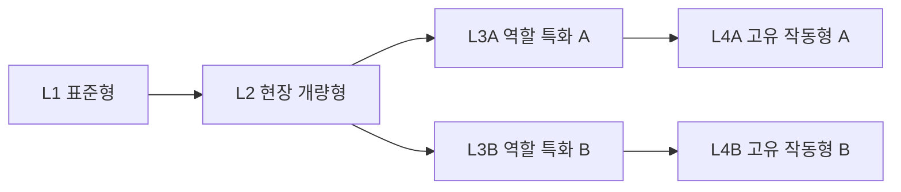

# 시그널 가드 — 타워 진화·그래픽·효과 통합 기획

2026-10-15 · 독립 캠페인/6인 구성 기획의 보강 문서

> 구현 추적: [P0/P1의 기존 16상태 계승·8분기 시연·첨부 32음원 적용](GUARD-CAMPAIGN-IMPLEMENTATION-20261015.md). 신규 L4 8종은 P2 범위이며 아직 미구현이다.

**범위: 기획 수정. 신규 진화·원화·음원·엔진 기능은 이번 작업에서 구현하지 않는다.** 현재 16개 타워 외형/실제 L3 분기와 후속 8개 최종 진화를 명확히 구분한다. 본 문서는 [독립 캠페인](DEFENSE-INDEPENDENT-CAMPAIGN-MASTER-PLAN-20261015.md), [캐릭터 구성](DEFENSE-CHARACTER-ROSTER-PLAN-20261015.md), [기존 전투 시청각](DEFENSE-COMBAT-AV-PLAN-20261015.md)을 함께 보강한다.

## 1. 목표: 실루엣만 봐도 내 선택을 알 수 있는 진화

타워는 장비 숫자를 늘리는 대신 **같은 계열을 내 전략에 맞춰 길들이는 대상**으로 만든다. L1에서 만든 작은 대응기가 L2의 정돈된 장치, L3의 분명한 특화, 최종 진화의 고유 작동 방식으로 이어진다. 진화하면 형태·발사 리듬·피격 모양·소리·적을 다루는 방식이 함께 달라져야 한다.

완성형은 **4계열 × 6개 노드 = 24개 장비 상태**다. 현재 L1/L2/L3A/L3B 16개를 바탕으로 L4A/L4B 8개를 추가 제안한다. 24개가 모두 현재 구현됐다는 뜻이 아니며, 수를 맞추기 위한 자산 이름 변경도 하지 않는다.

## 2. 두 모드에서 계승하는 장점과 가드식 변환

| 확인한 기반 | 가드에 계승할 장점 | 그대로 복제하지 않을 부분 |
|---|---|---|
| 브레이커: 6장비×4개 개조 외형, 실제 시연, 영구 개조/작전 진화 분리 | 실제 보유 단계와 미리보기를 구분, 단계마다 몸체 변화, 엔진 시연 | 영구 재료 노가다·젬을 정규 디펜스 입장/필수 성장 조건으로 이식하지 않음 |
| 브레이커: 연쇄·흡인·직선 관통·원형 판정으로 조합 차별 | 최종 진화가 공격 모양과 표적 처리 방식을 바꿈 | 디펜스에 없는 흡인/관통을 광선 이미지 하나로 있다고 표시하지 않음 |
| 브레이커: 발사된 탄의 조합/분기 스냅샷 유지 | 발사 뒤 개조·매각·재배치해도 이미 발사된 공격의 정체성 보존 | 브레이커 세이브·부품·전투 상태를 공유하지 않음 |
| 워치: 장비의 몸에 붙는 위치·발사 시작점·실제 설치물 위치를 구별 | 타워의 부품 위치와 발사 원점, 실제 필드/감속 위치 일치 | 워치의 안전장비 효과를 실제 산업 안전 성능으로 설명하지 않음 |
| 워치: 성장 재료/진화 조합과 역할·제약을 함께 표시 | 무엇을 얻고 무엇을 포기하는지 보여주는 분기, 장비 간 협력 | 같은 진화 조건을 복사해 불필요한 ‘재료 타워’ 구매를 강제하지 않음 |
| 워치: Signature 예고·대응·마무리, 실제 결과 기반 인계 | 위험을 읽고 준비한 방어선이 큰 해소로 이어지는 리듬 | 다른 모드 완료나 PERFECT 기록을 가드 필수 해금 조건으로 삼지 않음 |

근거: [브레이커 진화 구현](SIGNAL-BREAKER-EVOLUTION-IDENTITY-20261015.md), [워치 장비/효과 설명](SURVIVORS-CHARACTER-EQUIPMENT-DETAILS.md), `src/engine/survivors-signature-{events,mastery}.ts`, [인계 구현](SURVIVORS-HANDOFF-WORLD-BRIDGE-IMPLEMENTATION-20261010.md). 과거 문서의 캐릭터 목록은 최신 디펜스 6인 명단을 덮어쓰지 않는다.

## 3. 현재 실제 분기 — 이름과 효과를 혼동하지 않는다

현재 데이터 기준은 `content/defense/zero-breach-v1.json`, tick=50ms다. 아래는 기존 값이며 새 밸런스 확정안이 아니다. PURE는 게임 내 장갑 무시 대응력이다. 실제 설비/작업자의 안전 수치가 아니다.

| 계열 | L3A의 현재 성능 | L3B의 현재 성능 | 지금 표현할 수 없는 주장 |
|---|---|---|---|
| PULSE | 물리20 / 0.45초 / 거리170 / 단일 | PURE26 / 0.90초 / 거리195 / 단일 | B가 이미 뒤의 여러 적을 관통한다는 설명 |
| BURST | 물리34 / 1.80초 / 반경100 / 최대8 | PURE36 / 2.00초 / 반경50 / 최대3 | 모든 보이는 파편이 별도 피해라는 설명 |
| CONTROL | PURE8 / 1.00초 / 반경55 / 최대3 / 감속55%·1.8초 | PURE6 / 1.00초 / 반경105 / 최대7 / 감속35%·2.0초 | 강감속을 완전 정지나 영구 구속으로 표현 |
| SENSOR | PURE14 / 0.90초 / 거리185 / 탐지반경220·4초 | PURE25 / 0.75초 / 거리145 / 탐지반경145·3초 | B가 이미 지속 광선/분석 누적 판정을 가진다는 설명 |

현재 몸체 자산 16개는 `public/assets/defense/premium-v1/`, 매니페스트는 `content/defense/premium-art-v1.json`이다. 공개 기본판에 연결된 최종 후보이며 Director의 최종 아트 승인과 동일하지 않다. 기존 발사체는 즉시 판정 뒤 보여주는 표현이다. 실제 비행/지연 판정을 새 진화에 넣을 때는 엔진과 저장도 바꿔야 한다.

## 4. 성장 구조 — 보유 연구와 작전 중 진화를 분리



4계열 모두 위 구조를 쓰되 이름·형태·행동은 각자 다르다. L3A에서 L3B로 선을 다시 연결하지 않는다. 선택 전 비교는 무료이고 확인 전 취소할 수 있다. 확정한 분기는 작전 중 기존 매각/재설치 또는 별도로 정의된 전환 규칙으로만 바꾼다. 버튼을 닫았다 여는 것으로 분기 비용을 회수하지 않는다.

| 성장 층 | 무엇이 남는가 | 전투 비용/판정 |
|---|---|---|
| 영구 운용 기록 | 분기 설명·시연·외장·숙련 도면·작전 서명 | 피해/가격을 몰래 바꾸지 않음 |
| 작전 중 타워 성장 | 현재 패드의 L1→L2→선택 L3→선택 L4 | 실제 R 사용, 한 타워 한 분기 |
| 동료 전술 | 선택한 1인의 기본 능력/후속 수평 특화 | 타워 진화와 독립. 특정 인물을 고르지 않았다고 장비 트리가 사라지지 않음 |

기본 4계열과 기존 L3 양분기는 처음부터 정상적으로 사용할 수 있다. 초보에게 단계적으로 안내하되 필수 대응 장비를 잠그지 않는다. 최종 진화는 **GD-03 1회 클리어 이후 8개 모두 선택 후보로 공개**하는 안을 권장한다. 과금·광고·다른 모드·3별·반복 재료를 요구하지 않는다. 실제 사용에는 작전 중 해당 L3와 충분한 R이 필요하다.

한 작전에서 동시에 운용하는 L4는 **최대 1기**로 제안한다. 나머지 타워는 L3까지 정상 운용한다. 궁극 타워를 여럿 늘어놓는 대신 방어선의 주역 하나와 이를 돕는 배치를 선택하게 한다. L4 매각 시 슬롯 해제·환급·쿨다운·재설치 규칙을 명시하고 차익/충전 반복 악용을 검사한다. 최종 진화는 자동 작동하며 지원 버튼을 여러 개 더 만들지 않는다.

이 규칙과 L4 ID는 아직 현재 `DefenseLevelId`에 없는 후속 설계다. 기존 표준 훈련/재구성 이벤트는 그대로 보존하고 독립 캠페인 버전에 새 규칙을 적용한다.

## 5. 24상태 외형·리듬 설계

표의 L1~L3는 현재 규칙에 맞춰 보강하는 미술/표현 목표, L4는 새 기능을 동반하는 기획이다. 몸체 크기만 커지거나 색만 바뀌는 진화는 불합격이다.

### 5.1 펄스 대응기 — ‘빠르게 잇기’와 ‘한 축을 꿰기’

| 노드 / 제안 표시명 | 몸체 변화 | 발사·피격·소리 | 역할·포기 |
|---|---|---|---|
| L1 단일 맥동기 | 작은 압력실·단일 방출구 | 짧은 황금 꼬리, 작은 접촉 섬광, 건조한 타격 | 값싼 기본 단일 대응 |
| L2 이중 축압기 | 축압실·냉각 배관 추가, 지지대 확장 | 응축되는 코어와 선명한 한 발 | 연사/대응력 향상. 방출구가 둘이어도 현재 판정은 한 번 |
| L3A 고속 맥동기 | 회전식 짧은 방출부·급속 환기구 | 공격마다 실제 발사구를 번갈아 사용, 짧고 촘촘한 잔광 | 빠른 물리 대응, 장갑에 약함. 한 판정에 가짜 3발을 표시하지 않음 |
| L3B 축선 정밀기 | 긴 정렬 레일·좁은 방출구 | 가늘고 긴 백금색 선, 작은 선형 접촉, 묵직한 단발 | 현재는 장갑 무시 단일 대응. 아직 다중 관통 아님 |
| L4A 맥동 연쇄기 | 세 분리 방출부와 읽히는 순차 축압 표시 | 실제 순차 발사 3회의 시작/접촉, 금속성 3박자 | 유효 대응을 모아 짧은 점사 발동. 공격 횟수·전체 피해·대기시간을 엔진에 정의 |
| L4B 축선 관통기 | 길게 정렬된 레일·관통 중심 광학부 | 실제 좁은 관통축과 감쇠하는 후속 접촉점 | 중심 표적 뒤 정렬된 소수 추가 대응. 각도·폭·후속 피해 상한이 필요 |

L4A의 충전은 실제 유효 명중에만 쌓인다. 무적/없는 대상·헛발사·일시정지는 제외하고 발동 중 재충전 연쇄를 막는다. 충전은 타워 상태로 저장한다. L4B는 중심에서 뒤로 이어진 실제 선분/캡슐 판정과 최대 표적 수를 사용하며 화면의 넓은 광휘는 피해 폭이 아니다. 초기 표적 외의 모든 적을 화면 전체에서 관통하지 않는다.

### 5.2 분산 해소기 — ‘넓게 번지는 파동’과 ‘정확한 착탄’

| 노드 / 제안 표시명 | 몸체 변화 | 발사·피격·소리 | 역할·포기 |
|---|---|---|---|
| L1 방사 분산기 | 작은 접시·분산 노즐 | 낮은 포물선 표현과 작은 원형 접촉 | 기본 밀집 대응 |
| L2 다중 압력기 | 접시 지지대·압력실 확대 | 착탄 전 짧은 응축, 넓어진 국소 고리 | 실제 반경/최대 대상 증가 |
| L3A 광역 확산기 | 방사형 노즐·넓은 확산판 | 한 번의 해소 파동과 실제 다수 접촉, 넓은 저중역 | 넓은 물리 범위, 장갑 핵심에는 비효율 |
| L3B 집중 압력기 | 안쪽으로 모인 노즐·두꺼운 축압실 | 작은 고밀도 코어, 좁고 묵직한 충격 | 소수 장갑 대응. A처럼 큰 피해 원을 그리지 않음 |
| L4A 환형 쇄파기 | 두 겹의 방사 링·외곽 확산 프레임 | 중심→바깥의 실제 파동 진행, 지나간 구역의 잔광 | 넓은 유입 흐름을 순차 해소. 빈 구간으로 퍼지면 손해 |
| L4B 집속 착탄기 | 잠금식 압력실·삼점 고정 지지 | 짧은 지점 잠금→응축→집중 착탄, 절제된 저역 | 고정 착탄점을 제어와 맞추면 강함. 움직임을 놓치면 일부 빗나감 |

L4A는 파동의 진행 반경에 실제 맞은 대상을 기록한다. 기본안은 **한 파동에서 같은 적은 1회만 명중**이다. 두 고리가 보인다는 이유로 피해가 중복되지 않는다. L4B는 실제 지연 판정이 필요한 신규 규칙이다. 예고 지점을 저장하고 착탄 시 그 지점/반경의 유효 대상만 판정한다. 미리 피해를 준 뒤 나중에 폭발만 보여주는 방식으로 ‘빗나감’을 흉내 내지 않는다. 기본 L1~L3에는 기존 즉시 판정을 유지한다.

### 5.3 제어 고정기 — ‘좁고 강한 억제’와 ‘흐름을 다루는 경계’

| 노드 / 제안 표시명 | 몸체 변화 | 발사·피격·소리 | 역할·포기 |
|---|---|---|---|
| L1 단일 제어기 | 소형 드럼·고정 받침 | 청록 구속선과 짧은 기계 체결음 | 낮은 피해, 시간 확보 |
| L2 복합 고정기 | 한 쌍의 드럼·보강 앵커 | 실제 피격 대상에만 연결되는 짧은 선 | 소수 감속과 대응 범위 향상 |
| L3A 집중 억제기 | 무거운 소수 앵커·두꺼운 구속 프레임 | 좁은 구간의 굵은 체결선과 느려진 이동 | 최대3 강감속, 넓은 군집 제어는 포기 |
| L3B 광역 제어기 | 넓은 앵커 배치·얇은 분산선 | 넓은 구간의 여러 가는 연결선 | 최대7 약한 감속. 큰 원 전체를 완전 정지로 표시하지 않음 |
| L4A 삼점 고정기 | 3개의 중량 고정 팔·제한된 체결 슬롯 | 실제 붙잡은 소수에만 잠금 표식, 긴 낮은 체결음 | 제한된 일반 대상의 짧은 고정. 보스는 고정 대신 제한된 감속 |
| L4B 그물 경계기 | 두 유도 앵커와 선형 투영 프레임 | 실제 두 점 사이 경계선, 통과 시 접촉 맥동 | 좁은 선을 지나오는 흐름에 지속 감속, 경계 밖은 무효 |

고정과 감속은 다른 상태다. L4A는 대상 수·시간·보스 저항을 별도 정의해 영구 정지를 막는다. L4B의 선은 통행을 물리적으로 막는 벽이 아니다. 경계 영역을 통과할 때 감속하고 실제 사람/차량을 포획하는 연출은 하지 않는다. 중복 감속은 엔진의 합성 정책을 따라 상한을 갖게 하며 단순 덧셈으로 이동 속도를 음수로 만들지 않는다.

### 5.4 정밀 관측기 — ‘넓게 드러내기’와 ‘한 핵심을 끝까지 읽기’

| 노드 / 제안 표시명 | 몸체 변화 | 발사·피격·소리 | 역할·포기 |
|---|---|---|---|
| L1 단일 관측기 | 작은 광학 헤드·삼각 지지 | 보라색 짧은 스캔과 실제 단일 접촉 | 기본 탐지·보조 대응 |
| L2 복합 관측기 | 이중 광학부·정보 모듈 | 탐지 주기와 공격 시점을 구분 | 현재 반경과 확인 시간 확대 |
| L3A 광역 관측망 | 큰 접시·넓은 관측 헤드 | 실제 탐지반경 링, 확인된 신호의 작은 표식 | 넓고 긴 확인, 단일 화력은 낮음 |
| L3B 정밀 분석기 | 좁고 긴 광학 헤드·초점 링 | 짧고 선명한 정밀광과 작은 십자 | 단일 PURE 대응 강화. 현재는 분석 누적 없음 |
| L4A 다중 관측망 | 본체와 3개 작은 원격 관측점 | 각 점의 실제 탐지 영역이 순차 점등 | 떨어진 경로를 읽는 정보망. 관측점이 독립 공격 타워가 되지는 않음 |
| L4B 해석 집중기 | 조여지는 다중 초점 링·잠금 표시 | 한 대상 추적→읽히는 분석 축적→정밀 접촉 | 같은 핵심을 오래 볼수록 결정적인 대응, 목표를 잃으면 축적 감소 |

L4A의 관측점 위치와 반경은 순수 엔진이 결정한다. 허용된 경로 표본/배치 규칙을 사용하고 장식 빛이 비치는 모든 곳을 탐지했다고 처리하지 않는다. L4B의 ‘분석’은 이 타워의 전투 상태이며 PSI 공식/인물 지능 수치를 새로 만드는 것이 아니다. 유효 사거리·대상 생존·확인 상태에 따라 축적/감소를 정하고, 아직 구현되지 않은 벽 차폐 판정을 있다고 설명하지 않는다.

## 6. 워치식 조합을 디펜스의 공간 전략으로 변환

단순히 ‘재료 타워 두 개를 사면 새 타워’로 끝내지 않는다. **동료의 지원 타이밍 + 타워의 역할 + 실제 경로 위 위치**가 조합을 만든다. 아래는 별도 숨은 보너스를 자동 지급하는 레시피가 아니라 서로 보완하는 운용안이다.

| 조합 이름 | 구성 예 | 플레이에서 관찰할 것 | 오해 방지 |
|---|---|---|---|
| 모아 해소 | CONTROL 광역/경계 + BURST 광역/쇄파 | 묶인 흐름에 실제 범위 접촉이 집중 | 겹친 원 자체에 공짜 피해 없음 |
| 핵심 절단 | 윤성호 표식 + PULSE 정밀/관통 | 표식 대상과 뒤 정렬된 소수의 처리 | PURE에 장갑 감소를 이중 보너스로 적용하지 않음 |
| 정시 착탄 | 강태식 정리 + BURST 집속 | 고정 착탄점에 위험이 남아 있는 순간 | 실제 지연 착탄 전에는 피해 없음 |
| 시야의 다리 | SENSOR 관측망 + 먼 지점 PULSE | 드러난 표적이 실제 공격 범위에 들어오는지 | 탐지했다고 모든 타워의 사거리가 무한이 되지 않음 |
| 교대 한 발 | 이재훈 교대 가동 + 느린 고위력 장비 | 실제 공격 준비 완료로 한 발의 타이밍이 달라짐 | 발사 중 공격 복제/무한 초기화 금지 |
| 선을 다시 긋기 | 플레이어 재배치 + 최민석 유도 지원의 각 독립 운용 | 바뀐 패드/방향에서 범위와 표적 관계 재해석 | 기본 출전은 1인. 두 캐릭터 능력을 동시에 쓸 수 있다는 뜻 아님 |

임준호의 전역 확인과 최민석의 국소 방향 확장은 각각 정보와 공간을 보완한다. 강태식은 집중 구간 형성, 윤성호는 핵심 선택, 이재훈은 순간, 플레이어는 위치를 다룬다. 6인 각각 최소 두 계열과 유효한 운용이 있어야 하고 한 인물=한 타워의 강제 짝을 만들지 않는다.

## 7. 진화 화면 — 그림·트리·실제 시연을 하나로

### 7.1 한 계열에 집중하는 도면 화면

상단에 4계열 탭, 중앙에 선택 계열의 6노드 도면, 하단/측면에 실제 미리보기를 둔다. L1→L2 뒤 물리적인 두 지지대/배선처럼 A/B 선이 갈라지고 각 최종 노드까지 이어진다. 동료 트리와 장비 트리를 한 그림에 겹쳐 읽을 수 없게 만들지 않는다.

노드는 **현재 장착 / 지나온 노드 / 지금 선택 가능 / 자원 부족 / 캠페인 미공개 / 다른 분기**를 색 외에 선·표식·한글로 구분한다. 선택해 본 미리보기에 ‘장착됨’을 표시하지 않는다. 선택 경로만 약하게 맥동시키고, 움직임 줄이기에서는 정적 선을 유지한다.

### 7.2 진화 선택 카드의 필수 정보

1. 바뀌는 **행동 한 줄**: ‘좁은 축의 뒤 표적까지 이어 대응’처럼 구체적으로 표시.
2. 얻는 것과 포기하는 것 각각 한 줄.
3. 현재/변경 후의 실제 값: 지금 비용, 누적 투자, 잔여 R, 간격, 사거리, 반경/폭, 대상 수, 감속/탐지/충전 규칙.
4. 현재 보유/선택 미리보기의 몸체와 같은 표적 편성에서의 시연.
5. 작전용/영구 운용 기록의 구분, L4 슬롯 사용 여부.

단일 DPS 숫자로 모든 역할을 줄 세우지 않는다. 광역은 실제 피격 수, 제어는 느려진 구간과 시간, 탐지는 확인 범위/유지, 정밀은 핵심 표적에 집중한 피해를 비교한다. 아직 시뮬레이션하지 않은 미래 파를 근거로 확정 처치 수/승률을 제시하지 않는다.

### 7.3 시연 계약

현재 규칙과 후보 규칙을 동일한 별도 샌드박스에서 재생한다. 실제 domain/engine을 사용하되 본편/진행 중 작전/저장소에는 쓰지 않는다. 기본 시연은 일반 흐름·밀집·장갑 핵심·은폐 중 고를 수 있게 하고, 한 번에 선택한 하나만 재생한다. L4 후보 기능이 엔진에 없으면 ‘제작 예정 도면’으로 보여주며 실제 시연인 척하지 않는다.

닫기·다른 탭·화면 밖·페이지 숨김에서는 시연/오디오/타이머를 정리한다. 실제 전투는 정지된 채로 유지한다. 미리보기의 2배속이 작전 속도나 전투 RNG를 바꾸지 않는다. reduced-motion에서는 정적 범위·시퀀스 3컷·수치 비교로 같은 정보를 제공한다.

## 8. 진화 순간의 만족감 — 중단 없이 알아보게

진화 확정 → 실제 비용/상태 변경 → 몸체 교체 → 부품의 짧은 전개/빛의 응축 → 다음 실제 공격에서 새 패턴 확인의 순서를 쓴다. 화면 중앙 축하 창이나 전체 흰색 플래시는 넣지 않는다. 선택창에서 확인하고 닫으면 현장에 새 몸체가 남아 있어야 한다.

일반 업그레이드는 0.2~0.4초, L3 분기는 0.4~0.6초, L4는 0.6~0.9초의 국소 연출을 목표로 한다. 이 시간은 미술 목표이며 전투 피해를 정지/지연시키는 규칙이 아니다. 준비/정지 중 진화하면 전투를 자동 재개하지 않는다. 큰 몸체의 전개가 패드 터치/출구/경로를 덮지 않도록 바닥 풋프린트와 높이를 분리한다.

진화 시 기계 조립음 한 번, 이후 실제 새 공격에서 고유 사운드를 들려준다. 큰 성공음을 반복해 재생하지 않는다. 같은 종류 여러 기를 개량할 때 한 묶음으로 절제하고 전투 경보가 우선한다.

## 9. 그래픽 제작 명세와 납품 수량

### 9.1 몸체·부품·공간

- 현재 16종은 자동 폐기하지 않고 카메라·재질·실루엣·진짜 발사구·화면 축소 시 구분을 재검수한다. 불합격한 자산만 실제 새 최종 후보로 교체한다.
- 신규 최종 몸체는 L4A/B **8종**이다. 전체 목표는 24종이며, UI/시연/현장/결과는 같은 자산 ID를 쓴다. 원화 신규 제작량은 기본 8종 + 기존 16종의 검수 후 교체분이다.
- 관측점/유도 앵커/방출부 전개는 필요한 공통 부속으로 별도 납품한다. 부속을 새 타워/새 진화 수로 세지 않는다.
- 일관된 높은 시점, 황색 하우징·강철·구리·절제된 신호광, 같은 광원과 접지 그림자를 유지한다. 구역 조명 보정이 타워의 고유 색/형상 정보를 지우지 않게 한다.
- 모든 상태의 투명 여백과 실제 오브젝트 경계를 검수한다. 칸을 균등 분할해 노즐/접시/케이블을 잘라내지 않는다. 배경/체커보드를 알파로 오인하지 않는다.
- 몸체 실루엣·상부 장치·작동 부속 중 최소 두 요소가 부모 단계와 달라야 한다. 새 색과 글자만으로 진화 판정을 통과하지 않는다.

### 9.2 실제 발사 원점과 표현 프로파일

각 타워 자산에 바닥 기준점, 발사구/광학구의 정규화 좌표, 부속 피벗, 선택/충전 표식 위치를 기록한다. 이미지마다 같은 하드코딩 `x+20,y-30`에서 발사하지 않는다. 노즐이 여러 개인 경우 실제 선택한 노즐 ID를 사용한다. 월드의 표적 좌표와 이미지 내 발사구 좌표를 같은 방향 투영으로 변환한다.

표현 프로파일은 `towerId + levelId + contentVersion`으로 고른다. 공격 모양은 계열뿐 아니라 분기/최종 노드까지 반영한다. 장착/충전/지원 버프가 바뀌어도 몸체와 실제 공격의 단계가 엇갈리지 않게 한다. 세로/가로 투영에서도 발사 시작점이 몸체를 떠나지 않아야 한다.

### 9.3 매니페스트와 납품 체크

최종 자산마다 원본·참조·프롬프트·사용 조건·추출 경계·해시·버전·runtime URI·검수 상태를 보존한다. `FINAL_CANDIDATE_RUNTIME_INTEGRATED`와 사람의 최종 시각 승인을 구분한다. 이번 문서에는 제작 브리프만 작성했으며 8종 원화를 새로 생성하지 않았다.

## 10. 효과와 사운드의 계열별 언어

| 계열 | 빛/모양 | 시간 리듬 | 사운드 방향 | 반드시 읽혀야 하는 정보 |
|---|---|---|---|---|
| PULSE | 황금/백금, 짧은 연사 또는 좁은 축 | A 빠른 점 / B 여백 있는 선 | A 마른 반복 어택 / B 낮고 단단한 시작과 금속 잔향 | 한 발·점사·실제 관통 표적의 차이 |
| BURST | 호박색, 퍼지는 원 또는 작은 중심 | A 바깥으로 전파 / B 잠금 후 착탄 | A 퍼지는 저중역 / B 짧은 응축과 집중 충격 | 파동이 도달한 곳과 실제 착탄점 |
| CONTROL | 청록, 체결점·선형 경계 | 오래 유지되는 연결과 통과 반응 | 낮은 체결/짧은 경계 접촉 | 강감속·고정·경계 밖 무효의 차이 |
| SENSOR | 보라/백색, 관측 링·초점 십자 | A 순차 스캔 / B 한 점 축적 | A 간헐적인 확인음 / B 얇은 초점 상승 후 접촉 | 확인된 범위·누적 중인 표적·사거리 이탈 |

색만으로 구별하지 않고 실제 형상과 한글 설명을 병행한다. 스캔 링이 경로를 덮는 불투명 장판이 되지 않게 한다. 보스 핵심/누출 경보/지원 정보의 시각 우선순위를 고정한다.

전투 효과는 기본안으로 동시에 최대24개 대표 공격 그룹, 지속 필드는 최대3개 논리 그룹을 목표로 한다. 관측점 여러 개는 하나의 소유 그룹으로 관리한다. 한계를 넘으면 기존 중요도/짧은 수명/간소화로 표시량만 조절하며 적·판정·피해는 삭제하지 않는다. 세부 수치는 실제 기기 검증 후 확정한다.

사운드는 현재 공격 버스의 최대8보이스를 출발점으로 한다. 점사 3발/군집 다수 명중을 실제 시간 범위 안에서 묶고, 모든 작은 파편에 소리를 하나씩 할당하지 않는다. 음악/대사/핵심 경보와의 우선순위를 유지한다. 음소거·정지·탭 숨김은 예약된 소리까지 끊는다.

현재 3개 원음의 필터/피치 믹스만으로 8개 최종 진화의 차이를 충분히 낼 수 있다고 확정하지 않는다. 실제 청취로 부족한 계열의 신규 샘플을 제작한다. 원본 생성 서비스·요금제·입력·상업 이용 조건을 기록하며, 추가 음원이나 권리가 이미 확보됐다고 주장하지 않는다.

## 11. 엔진·저장 계약 — 화려함을 실제 규칙과 묶는다

현재 `DefenseCombatShot/Frame`은 실제 명중 뒤의 표적/피해/해소를 전달한다. 새 지연 공격을 위해 기존 명중 프레임을 발사 시점에 미리 내보내면 안 된다. 필요한 후속 출력은 다음처럼 역할을 분리한다. 이는 설계 예시이며 현재 타입에 추가된 상태가 아니다.

```ts
type PlannedCombatOutput =
  | {kind:'launch'; attackId:string; sourceTowerId:string; snapshotId:string; origin:Point; targetPoint:Point}
  | {kind:'impact'; attackId:string; targetId:string; point:Point; actualDamage:number; resolved:boolean}
  | {kind:'field'; fieldId:string; sourceTowerId:string; activeFromTick:number; activeUntilTick:number};
```

새 최종 진화의 대기 공격/충전/분석/경계/파동은 순수 엔진 상태다. 타워 ID·분기·피해 타입·비용 버전·발사 원점·목표/방향·필요 계수는 발사 시점의 스냅샷으로 고정한다. 발사 후 업그레이드/매각/이동해도 이미 발사된 공격이 새 장비의 효과로 바뀌지 않는다. 단, 표적 생존/범위와 지연 착탄 시점 판정은 각 공격 계약대로 평가한다.

순차 점사/진행 파동/대기 착탄/관측점은 유일한 소유 ID와 만료 틱을 가진다. 상한·매각 시 유지/종료 정책·새 파 전환 정책을 콘텐츠에 명시한다. 저장 재개로 중복 명중/충전/자원 지급이 일어나지 않아야 한다. 이전 스키마에 없는 L4를 구버전 앱이 잘못 읽지 않도록 캠페인 rules/content 버전과 이관/복구를 함께 설계한다.

감속·탐지·고정·장갑 변화는 합성 순서를 정한다. 윤성호 표식과 PURE의 이중 증폭, 이재훈의 무한 공격 초기화, 플레이어 이동으로 충전/대기시간 리셋, 최민석 범위가 탐지까지 잘못 넓어지는 사례를 금지한다. 로컬 UI 타이머·애니메이션 완료 콜백으로 추가 피해를 넣지 않는다.

## 12. 제작 패키지 — 기존 계획과 맞춘다

| 단계 | 진화 납품 | 캐릭터/작전과의 결합 | 진행 조건 |
|---|---|---|---|
| P1: GD-01~03 | 현재 16상태/8분기의 실루엣·발사구·분기별 효과·실제 값·시연·트리 가독성 보강 | 기존 2능력+윤성호/이재훈 기본 능력, 총4명 | 4계열×A/B의 선택 차이를 실제 전투에서 설명할 수 있음 |
| P2: GD-04~06 | 신규 L4 8종의 엔진·몸체·고유 효과·1기 슬롯·해금·저장. 일부를 최종처럼 먼저 공개하지 않음 | 6인 구성, 복수 경로/전환/지하와 조합 | 8종 모두 정상 구매/시연/완주/재개 검증. 미달이면 기존 L3 캠페인 단면 유지 |
| P3: GD-07~12 | 매듭 보스와 최종 진화의 상호작용, 도면·전술 회고·도전 | 인물의 같은 능력이 다른 현장에서 다른 선택을 만듦 | 특정 L4/동료의 강제 조합 없이 캠페인 완주 |
| 후속 | 외장/추가 전술 갈래, 필요한 새 계열 | 기존24상태와6인이 충분히 다른지 먼저 확인 | 신규 기능이 기존 계열의 재색칠이면 추가하지 않음 |

P2는 기존 계획보다 제작량이 늘어난다. 복수 경로·6인·8최종 진화를 한 번에 공개하지 않고 내부적으로 **L4 공통 상태/저장 → 4쌍 검증 → 공간/캐릭터 교차 검증** 순으로 닫는다. 일정 때문에 기능 없는 몸체만 ‘최종 진화’로 공개하지 않는다. 첫 구역이 재미없으면 P2 확대 전에 GD-01~03의 배치/밀집/시청각을 수정한다.

## 13. 검증과 합격 기준

1. **기획 정합성:** 4계열×6노드=24, 기존16/신규8 구분, 부모 노드/분기 일치, 자산 ID·현재 수치·tick 환산을 원본 데이터와 대조한다.
2. **작동 차이:** 각 A/B 쌍을 동일 일반/밀집/장갑/은폐 편성에서 비교한다. 어떤 상황에 어떤 분기가 유리한지 설명할 수 없으면 분기 재설계. 전 상황 최상위인 노드를 목표로 하지 않는다.
3. **실제 판정:** 점사별 표적/피해/간격, 관통축과 감쇠/대상 수, 파동의 중복 명중 방지, 지연 착탄의 이동/사망 표적, 고정/보스 저항, 경계 진입/이탈, 관측점 합집합, 분석 축적/손실을 검사한다.
4. **상태와 경제:** 정확한 비용, L4 슬롯 1기, 매각/재배치/쿨다운·충전 보존, 더블탭·자원 부족·일시정지·숨김·저장/재개·구버전 처리.
5. **미리보기:** 같은 엔진/후보값, 실제 보유/미리보기 구분, 시연 후 실제 작전/저장/RNG 불변, 닫힌 시연/음원/타이머 해제.
6. **시각/청각:** 부모/자식 실루엣·발사점 일치, 8분기/8최종 효과 고유성, 실제 범위보다 큰 피해 표시 없음, 48체 스트레스 시 경로/출구/경보 가독성, 8보이스 예산과 음소거 정리.
7. **모바일/PC:** 세로·가로 동일 월드 판정, 44px 터치 목표, 한글 역할/제약, 모션 줄이기에서 동일 정보. 실기 메모리·긴 프레임·발열·청취를 측정한다.
8. **교차 조합:** 8최종×6인=48개의 대표 조합 시뮬레이션을 계획하되, 시간/시드/배치/콘텐츠 버전을 기록한다. 정규 12작전의 인간 플레이 및 모든 가능한 배치 전수 검증과 구분한다.

이번 문서 작성에서는 기획 노드·현재 수치·기존 자산 경로·문서 링크의 정합성만 검사한다. 신규 8최종 진화의 재미/성능/원화/소리를 검증 완료했다고 보고하지 않는다.

정규화한 [24노드 카탈로그](planning/defense-tower-evolution-v1.json)에는 현재16노드의 원본 수치/공격 간격/실제 이미지 URI와 신규8노드의 부모·고유 작동안·미구현 상태를 기록했다. [기획 검증 기록](planning/defense-tower-evolution-validation-20261015.json)은 4계열/24노드, 분기 부모, 원본 수치/기존16이미지, GD-03 해금 참조, 문서 표기를 대조한 결과다. 48개 캐릭터×최종 진화 조합은 앞으로 수행할 검사 수이며 이번에 플레이한 횟수가 아니다.
