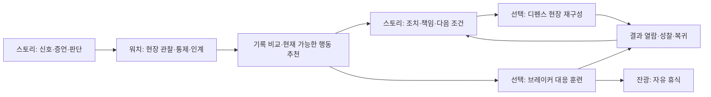

# NEW PSI : ZERO DAY — 전체 게임 정합성 검증·통합 종합기획서

작성일: 2026-10-15 · 검증 기준: `7a8dfa62d6829dc4de87a892e3320c5861d2152d` · 브레이커 `0.66.0-evolution-identity`

**문서 상태: 현재 구현 감사 + 후속 제작 제안.** 이 문서가 새 캠페인, PSI 공식, 모드 공개, 아트 최종 승인을 대신하지 않는다. 기존 최상위 원칙과 승인된 Episode 01의 26-event 구조를 유지한다. 검증 가능한 계약과 출시 차단 기준으로 오류를 줄이며, 무결함을 보증하지 않는다.

후속 진행: 사용자의 디펜스 우선 구현 요청에 따라 [디펜스 구현 보고](DEFENSE-TACTICS-IMPLEMENTATION-20261015.md)를 추가했다. 아래 현재 상태 감사는 `7a8dfa62` 당시의 기록이며, 이후 디펜스 기본 훈련 진입·추천·성장·저장 보수 결과는 후속 보고를 따른다.

## 1. 결론과 제작 방향

세계관의 핵심인 **작은 신호를 듣고 → 근거를 비교하고 → 위험의 연쇄를 끊고 → 사람과 기록에 다음 날의 변화를 남긴다**는 방향은 구현에 남아 있다. 캐릭터의 공통 자산, 워치의 안전통로 퇴장, 순찰 인계, 스토리의 판단·후속 결과, 브레이커의 비인간 위험 신호가 그 근거다. 다만 모든 모드가 하나의 사건·시간·저장으로 완전히 연결된 게임은 아직 아니다.

추천하는 통합은 네 장르를 의무적으로 순회시키는 방식이 아니다. **스토리가 사건의 원인과 책임을, 워치가 현장에서 몸으로 확인하는 관찰과 인계를, 디펜스가 제한된 자원의 배치와 연쇄 대응을, 브레이커가 같은 위험 문법을 변주한 고밀도 가상 대응 훈련을 담당**한다. 브레이커와 잔광은 바로 즐길 수 있는 독립 진입을 보존한다. 가상 훈련이라는 설정은 새 통합 서사 제안이며 현재 모든 대사에서 확정된 사실로 취급하지 않는다.

이번 제작의 최소 완성 단위는 **기존 본편 Episode 01 + 동일 경사로 사건의 짧은 인계 + 기존 디펜스 훈련/재구성**이다. 먼저 본편 TBM→FIELD와 전체 26개 이벤트의 시각·사운드·복귀 품질을 닫고, 연결 단면을 검증한 뒤 확장한다. 순타·역타·리모델링, 계절·현장종류를 동시에 제작하지 않는다.

### 상태 표기

| 표기 | 의미 |
|---|---|
| 확인 | 현재 소스·콘텐츠·이번 실행 결과에서 확인 |
| 기존 증거 | 앞선 검증 문서/로그의 결과. 이번에 같은 플레이를 다시 수행한 것은 아님 |
| 제안 | 이번 기획의 제작 명세. 아직 구현되지 않음 |
| 결정 필요 | 기존 승인 내용 변경 또는 새 세계관·공개 범위에 대한 Director 결정 필요 |

## 2. 근거의 우선순위와 확인 범위

충돌 시 **사용자의 최신 명시적 지정 → Master Design Principles·GAMEPLAY_DOCTRINE → 승인된 콘텐츠/자산 계약 → 현재 실행 소스와 실제 화면 → 날짜별 구현 보고 → 과거 제안서** 순서로 판단한다. 최신 날짜만으로 상위 원칙을 덮어쓰지 않는다. 현재 구현과 원칙이 어긋나면 구현을 정답으로 선언하지 않고 결함으로 기록한다.

핵심 근거:

- [최상위 원칙](MASTER-DESIGN-PRINCIPLES.md), [판단·교육 철학](../GAMEPLAY_DOCTRINE.md), [제작 규칙](../AGENTS.md).
- [본편 Episode 01](EPISODE-01.md), [최종 완주 게이트](EPISODE01-FINAL-PLAYTHROUGH-GATE.md), [시각 품질 기준](PHASE-D-VISUAL-QUALITY-REBASELINE.md).
- [디펜스 실행 기준](defense/DEF-HD00_BASELINE_LOCK.md), [현장 공간 설계](defense/DEF-HD01_MASTER_WORLD_LAYOUT.md), [현장·공법 확장 제안](defense/site-archetype-process-risk-system.md).
- [워치 인계 구현](SURVIVORS-HANDOFF-WORLD-BRIDGE-IMPLEMENTATION-20261010.md), [근로자 안전통로](SIGNAL-WATCH-WORKER-SAFETY-EXIT-20261014.md), [캐릭터 정합성 교정](CHARACTER-IDENTITY-CONSISTENCY-AUDIT-20261014.md).
- [브레이커 EP03](SIGNAL-BREAKER-EPISODE-THREE-20261014.md), [최신 군집·로비](SIGNAL-BREAKER-CASCADE-LOBBY-20261015.md), [최신 장비·진화](SIGNAL-BREAKER-EVOLUTION-IDENTITY-20261015.md), [잔광 구현](SIGNAL-BREAKER-AFTERGLOW-IMPLEMENTATION-20261015.md).

이번 감사는 위 문서와 실제 진입·저장·인계·본편·디펜스 데이터/엔진을 교차 확인한다. 전체 소스의 모든 줄·모든 이미지·모든 언어를 사람이 전수 검수한 것으로 해석하지 않는다. 자동 회귀, 공개 화면 확인, 앞선 캠페인 플레이 증거를 구분해 기록한다. 상업적 권리 전수감사는 별도 자료이며 이 문서의 정합성 통과로 권리 문제까지 해소되지 않는다.

## 3. 현재 구현 지도

| 영역 | 실제 구현·진입 상태 | 현재 한계 / 통합 의미 |
|---|---|---|
| 공통 허브 | `src/ui/GameHub.tsx`; 워치·브레이커 진입, 동료·기록·교본 | 공개 스토리·디펜스 버튼은 준비중 프리뷰. 엔진 존재와 공개 플레이 가능을 구분 |
| 스토리 | `src/app/main.tsx`가 `EpisodeSession.directed()` 생성; 26개 authored event, Day01→Day02 | 일부 과거 문서의 11~16개 조건부 경로는 현재 공개용 구조가 아님. 실제 허브에서 일반 사용자는 본편을 시작할 수 없음 |
| 워치 | `PatrolSurvivorsGame` + `patrol-survivors-engine`; 인물 선택, 현장 관찰·계도·통제·정리·인계 | 공격/해소와 사람의 계도·안전한 퇴장을 구분해야 함. 모든 배경 물체의 실제 보행 안전 시뮬레이션은 아님 |
| 디펜스 | `DefenseGame.tsx` + 순수 `engine/defense.ts`; ramp-01, 8패드, 4장비, 6위험형, 2지원, 10웨이브 | 본편 `StrategyMapShell`과 별개. 공개 준비중. 기존 경로·밸런스를 유지한 품질 검증이 선행 |
| 브레이커 | 별도 정적 앱 `public/signal-breaker-dev/`; 3에피소드 × 5작전; 6장비, 캐릭터, 영구 개조·소켓/작전 진화 | 본편 Episode01과 다른 진행. 워치/본편의 임무·통화·세이브와 자동 통합되지 않음 |
| 잔광 | 브레이커 `rest.html`, 별도 엔진·저장 | 휴식·장비 체험. 본편 필수 보상·성장 재료를 연결하면 휴식의 역할이 손상됨 |

### 3.1 이미 되는 연결과 아직 없는 연결

| 방향 | 확인된 동작 | 범위를 넘는 해석 금지 |
|---|---|---|
| 워치 STAGE12→13 | 유효한 최종 인계의 실제 정리 ID를 수신 통로에 반영. 재보상 없음 | 모든 구역이 하나의 연속 좌표라는 뜻 아님 |
| 워치→스토리 | 인계함이 현재 가능한 inspect 행동을 추천. 기존 선택·revision·비용으로 실행 | 기록 열람만으로 조사·증거 자동 완료 안 됨 |
| 워치→디펜스 | READY/INTERMISSION에서 CONTROL/SENSOR 배치 제안. 실제 비용·빈 패드·장비 제한 적용 | 무료 장비·전투 중 배치 특혜 아님. 인계 열람 후 자동 재개하지 않음 |
| 본편→디펜스 | `training-ramp-v1` 완료 + `ep01.ramp-signal-known`으로 `event-ramp-reconstruction-v1` 해금 | 아직 준비중인 공개 진입이 열린 것은 아님 |
| 워치↔브레이커 | 공유 배우 런타임·캐릭터 자산 및 같은 위험 주제 | 공통 임무·지속 세계 상태·쌍방 진행 동기화는 확인되지 않음 |
| 디펜스→본편 결과 | 이 문서에서 후속 제안 | 현재 실제 복귀·서사 반영이 완성됐다고 표시하지 않음 |

## 4. 정합성 감사와 우선 수정 목록

| ID / 중요도 | 발견·근거 | 기획상 보수 지시 | 통과 기준 |
|---|---|---|---|
| A01 / P0 | 본편/브레이커 EP01 표기가 다른 콘텐츠를 가리킴 | 내비게이션에 ‘본편 1화’와 ‘브레이커 EP01·작전01’을 분리. 내부 ID·세이브 키 유지 | 신규 사용자가 현재 모드/사건/복귀 위치를 설명할 수 있음 |
| A02 / P0 | 엔진/자산 존재와 공개 준비중 상태가 혼재 | 구현·공개·최종 시각 승인 세 상태를 별도 관리 | 준비중 프리뷰를 완성 모드·플레이 스크린샷으로 홍보하지 않음 |
| A03 / P0 | 과거 v2 세계관 문서에 PSI 레벨·면역100%·가상 집진/접지 묘사 존재 | ‘가상 대응 시뮬레이션’ 제안 확정 후 용어사전 정비. 승인 전 PSI 점수/공식 신규 정의 금지 | 실제 안전장비의 성능·작업 허가와 게임 수치를 혼동시키는 설명 없음 |
| A04 / P0 | 공유 얼굴은 있으나 BREAKER 진행은 별도 | 교차 진행은 검증된 결과 요약·추천으로 시작. 세이브 일괄 합치기 금지 | 손상·실패·재시도·구버전·저장 차단 시 본편 진행 손실 없음 |
| A05 / P1 | EP03 초기 문서의 6·11·4·14·8 / 12동시 제한이 이후 변경됨 | 현재 18·30·14·38·26 기본 대형 / 24공급 제한 / 엔진36상한을 최신 기준으로 참조 | 옛 표를 신규 난도 구현의 입력으로 쓰지 않음. encounterVersion1 복원 유지 |
| A06 / P1 | 장비 외형 불변/진화 동질성은 0.66에서 수정됨 | 해결된 결함을 다시 구현하지 않고 24외형·4조합×2분기 회귀 유지 | 영구 개조와 작전 진화를 구별, 실판정·외형·설명 일치 |
| A07 / P1 | 최신 캐릭터 검증은 순찰 요원 초상 기준. 옛 hires가 다른 얼굴이었던 이력 | 순찰 요원 승인 초상·공통 ID/별칭을 모든 제작 브리프의 참조로 고정 | 얼굴·안전모·소품·이름 조합이 전체 모드에서 일치 |
| A08 / P1 | PhaseD 상태 도구는 BINARY-READY, 새 화면의 체감 완성 판정은 별개 | TBM→FIELD부터 동일 기기 실제 화면 비교 승인 | 파일 수/해시만으로 VISUAL LOCK 선언하지 않음 |
| A09 / P1 | 기존 허브 회귀 테스트에는 ‘워치만 플레이 가능’이라는 옛 이름/문구가 남음. 실제 브레이커 링크 존재 | 허브 상태표·카피·테스트 명칭을 공개 가능 모드 2종과 맞추는 후속 정비 | 운영 버튼·안내·교본·테스트 설명이 같은 공개 상태를 말함 |
| A10 / P1 | 본편 완주 테스트와 일부 인계 테스트의 기본 세션이 서로 다름 | 새 통합 검증은 directed26 경로에서 수행 | 레거시/합성 테스트 통과만으로 현재 통합 완주를 선언하지 않음 |

P0는 상업 공개 전에 반드시 해소할 계약/표현 문제다. 이번 문서는 수정 설계이며 위 항목을 전부 런타임에서 고쳤다는 보고가 아니다.

## 5. 세계관 헌법과 용어

### 5.1 확정 원칙

1. PSI는 Proactive Safety Intelligence. 작은 징후·말·기록을 먼저 읽는 세계의 방향이다. 승인되지 않은 능력치 공식이나 실제 사업장 평가 지표를 새로 만들지 않는다.
2. 위험의 대상은 물체·설비·에너지·하중·분진·정보 단절이다. 사람은 적/전리품/타격 쾌감의 대상이 아니다. 워치 계도는 대화·안내와 안전한 이동으로 표현한다.
3. 안전의 최저선은 거래 대상이 아니다. 어려움은 부분 정보, 시간, 관계, 공정 압력에서 만들며 불법·위험한 지름길을 최고의 보상 경로로 만들지 않는다.
4. 올바른 조치에도 재배치·대기·설명·책임 기록의 비용이 있다. 무조건 정답 버튼을 누르면 모든 관계/일정까지 좋아지는 구조를 피한다.
5. 증언은 먼저 듣고, 불일치는 현장과 기록으로 확인한다. 직급·캐릭터 친밀도는 사실을 자동 확정하지 않는다.
6. 관계는 제보의 타이밍, 보고 위축, 팀 협조, 지시 전달로 드러난다. 사람을 영구적인 선인/악인 수치로 단순화하지 않는다.
7. 결과는 다음 장면의 동선·대사·기록·인계에 남긴다. 같은 배경에 성공 배지만 붙이는 것으로 끝내지 않는다.

### 5.2 통합 제안: 현실 현장과 가상 대응층

| 층 | 담당 | 표현·상태 경계 |
|---|---|---|
| 현장 서사 | 스토리, 워치 | 실제 인물의 관찰·제보·작업 통제·보호구·대피. 실제 위험을 마법처럼 소멸시키는 연출 금지 |
| 전술 재구성 | 디펜스 | 사건의 위험 전파를 축약한 배치 시뮬레이션. 훈련/재구성임을 브리핑과 결과에 짧게 명시 |
| 집중 대응 훈련 | 브레이커 | 위험 신호체의 반사·회수·연쇄·무기 진화. 화려함은 가상 표상 안에서 허용 |
| 비경쟁 휴식 | 잔광 | 압박 없는 정돈·광채·소리·자유 체험. 치료 효과·실제 안전 보증을 말하지 않음 |

‘가상’ 설명은 매 전투 팝업으로 반복하지 않는다. 최초 준비·교본·모드 정보에 일관되게 두고 전투에서는 몰입을 보존한다. 이 경계는 사용자의 손맛 요구와 건설현장 세계관을 함께 지키는 장치다.

### 5.3 표시 용어 제안

- 외부 표시: 본편 `1화: 오늘의 첫 신호`(가제), `시그널 워치: 순찰 작전`, `디펜스: 현장 재구성`, `시그널 브레이커 EP01~03`, `잔광`.
- 브레이커 ‘무기’는 교본에서 가상 대응 장비로 정의한다. 장비명·내부 식별자를 즉시 전면 개명하지 않는다.
- 실제 현장 ‘작업중지/재개’와 가상 대응 ‘일시정지/훈련 재시작’을 구별한다.
- ‘임무 완료’와 ‘안전 확인 완료’를 같은 의미로 쓰지 않는다. 확인 주체·대상·미확인 항목을 기록한다.
- 각 기록에 `모드 · 구역 · 사건 · 시점 · 결과`를 표시한다. 기존 CH/STAGE 식별자를 억지로 같은 번호로 맞추지 않는다.

## 6. 통합 플레이 구조 — 한 사건, 네 가지 손맛



이 도식은 목표 구조다. 현재 구현된 화살표의 범위는 3.1절을 따른다. 브레이커를 이겨야 대화가 열리거나 워치를 오래 반복해야 본편이 진행되는 의무 순환은 만들지 않는다.

### 6.1 신규 사용자 권장 경로

1. 허브에서 ‘이어서’ 한 개와 ‘바로 즐기기’를 제공. 모드 4개 설명을 한 화면에 길게 나열하지 않는다.
2. 본편 첫 신호에서 한 번의 관찰·증언·판단을 경험한다. 조작 교본은 필요한 조작 하나만 짧게 보여준다.
3. 현장 확인이 필요한 순간에만 워치의 짧은 선택 작전을 제안한다. 거절하면 본편의 정규 조사 선택으로 계속할 수 있다.
4. 인계 결과에서 “무엇을 봤고 / 아직 무엇을 모르는지 / 어디서 이어할지”를 보여준다.
5. 같은 사건의 대응 연습으로 디펜스 또는 브레이커를 제안한다. 선택한 훈련 완료 후 원래 본편 장면으로 돌아온다.
6. 기존 사용자는 새 튜토리얼 강제 재생 없이 마지막 체크포인트와 원래 장비를 복원한다.

### 6.2 교차 보상의 원칙

초기 통합 보상은 **대사·기록·상황별 추천·장식 해금**으로 제한한다. 브레이커 무기 공격력이 본편 판단 성공률이나 워치 사람의 행동을 직접 바꾸지 않는다. 디펜스 자원·브레이커 부품/젬·워치 성장 자원을 합치지 않는다. LIFE ARCHIVE는 엔딩/CG/주요 기록 해금의 기존 범위를 따른다. 반복 파밍 없이도 서사를 끝낼 수 있어야 한다.

## 7. 시그널 워치 ↔ 브레이커 연결 명세

### 7.1 연결의 주제와 실제 플레이 차이

| 위험 문법 | 워치에서 하는 일 | 브레이커에서 느끼는 쾌감 | 본편에서 남는 질문 |
|---|---|---|---|
| 반입·이동 | 사각·교차동선 확인, 제동·분리, 인계 | 금속 군집 유도·반사·연쇄 회수 | 누가 변경 동선을 전달받지 못했나 |
| 분진·시야 | 발생 위치·방향 관찰, 구역 통제 | 미스트 안정화 후 밀집 해소 | 기록과 바람/작업 조건이 왜 다른가 |
| 전력 | 접근 경계·설비 상태를 관찰·보고 | 연결 노드 단절·스캔·패턴 돌파 | 에너지 상태를 누가 확인했나 |
| 하중·장력 | 경고·양중 범위와 통로를 구분 | 앵커·관통·중계핵 대응 | 일정 압력 속 변경 지시가 어떻게 전해졌나 |

실제 작업 절차·설비 성능을 설명하는 문구는 현장 전문가 검토 전 확정하지 않는다. 위 표는 게임 플레이 역할 매핑이다.

### 7.2 첫 연결 단면 제안

새 사건을 늘리지 않고 경사로/반입의 기존 신호 하나를 사용한다. 워치 인계함의 정리·통제 기록에서 브레이커 ‘반입 대응 훈련’을 선택하면 전투 준비로 이동한다. 최초에는 **현재 일반 해금 규칙 안에서 가능한 작전만** 제안한다. 미해금 에피소드 강제 개방이나 가상 부품 지급은 하지 않는다. 적절한 작전이 없으면 ‘브레이커 기본 훈련’ 또는 원래 화면 복귀만 제공한다.

브레이커 결과는 “훈련에서 관통 배치를 사용함 / 중계망 우선 처리 경험”처럼 훈련 기록으로 돌아온다. “현장 경사로가 안전해짐”이나 “누전이 제거됨”이라는 사실로 변환하지 않는다. 실제 현장 상태 변화는 기존 본편/워치의 정상 행동이 확정한다.

### 7.3 전달 데이터 초안 — 구현 전 스키마 확정

기존 `OperationHandoff` v1은 워치 전용으로 보존한다. 다음은 새 연결 어댑터의 제안 필드이며 기존 저장을 덮어쓰는 새 통합 세이브가 아니다.

```ts
type BridgeSummaryV1 = {
  schemaVersion: 1;
  sourceMode: 'watch' | 'breaker' | 'defense';
  sourceRunId: string;       // 완료 실행의 안정된 ID, 재열람 중 새로 생성 금지
  sourceContentVersion: string;
  contextId: string;         // 승인된 사건-구역 매핑표의 키
  result: 'completed' | 'failed' | 'abandoned';
  factIds: string[];         // 모드별 허용목록; 훈련 사실과 현장 사실 분리
};
```

수신 규칙: 스키마/버전/매핑/허용 fact 검증 → 출처별 정상 완료인지 확인 → 열람/추천 투영 → 사용자가 기존 명령으로 선택. 원시 저장 객체·임의 URL JSON·수치 점수를 신뢰해 본편 상태를 바꾸지 않는다. 로컬 저장은 변조 방지 인증 자료가 아니며 외부 자격/안전 판정에 쓰지 않는다.

`contextId`에는 승인된 소규모 대응표만 둔다. STAGE12와 모든 CH01을 번호가 비슷하다는 이유로 같은 장소로 매핑하지 않는다. 현재 v1 인계에는 안정된 run ID·사건 ID가 없으므로 이를 이미 구현된 것으로 가정하지 않는다. 신규 기록부터 어댑터를 붙이고 과거 기록은 열람 전용으로 남기는 방식을 우선한다.

## 8. 디펜스 모드 상세 기획

### 8.1 정체성·승패·보존할 기반

디펜스는 ‘사람을 막는 포탑 전쟁’이 아니라 **위험의 전파 경로를 읽고, 제한된 개입 자원을 어디에 둘지 결정하는 현장 재구성**이다. 판정은 기존 엔진이 소유하며 렌더러는 실제 경로·사거리·상태를 그린다.

기존 기준선: ramp-01 **1000×600 / 8패드 / 10웨이브 / 50ms tick / 초기 방호20·자원200 / 속도1·2배**. 기본 경로 `(0,300)→(180,300)→(180,150)→(450,150)→(450,450)→(720,450)→(720,240)→(1000,240)`를 배경에 맞춘다는 이유로 몰래 이동하지 않는다. P1~P8의 좌표는 기존 콘텐츠를 그대로 따른다. 승리·패배·보상은 현재 엔진/시나리오 규칙을 재사용하며 수치 변경은 별도 밸런스 변경표와 회귀를 요구한다.

### 8.2 네 장비의 체감 분화

| 기존 ID | 화면에서 먼저 읽힐 역할 | 선택 이유 | 포기하는 것 / 검수 |
|---|---|---|---|
| PULSE | 짧고 정확한 단일 대응 | 우선 위험을 안정적으로 줄임 | 밀집 대응은 제한. 실제 단일/범위 판정과 시각 일치 확인 |
| BURST | 분산·밀집 대응 | 작은 신호가 한꺼번에 쏟아질 때 | 장갑 핵심 대응과 차별. 실제 엔진 수치로 설명 |
| CONTROL | 속도·간격 제어 | 교차점에서 대응 시간을 벌기 | 단독 해결력이 높은 것처럼 표현하지 않음 |
| SENSOR | 가려진 신호 확인·다른 개입 지원 | 정보가 부족한 후반 경로 | 직접 화력과 비교되는 기회비용을 안내 |

표는 플레이어에게 전달할 역할 기획이다. 현재 엔진 효과가 문구와 다르면 먼저 데이터/수치를 확인하고 문구를 고친다. 기능이 없는데 새 그림만으로 기능이 있는 것처럼 표시하지 않는다. 지원 COORDINATOR/OBSERVER도 기존 실제 효과·사용 가능 시점·재설정 조건을 그대로 표시한다.

현재 데이터에서 확인한 **이미 존재하는 분기**는 다음과 같다. 브레이커의 진화와 별개의 디펜스 트리이므로 같은 이름/그림으로 덮어쓰지 않는다. 수치는 게임 내부 값이며 실제 장비 성능이 아니다.

| 장비 | L1→L2→L3A / L3B | 최종 선택의 실질적 차이 |
|---|---|---|
| PULSE | 비용80→60→110/110 | A: 물리20·9tick 간격·거리170 / B: PURE26·18tick·거리195. 연사와 장갑 대응 선택 |
| BURST | 110→80→130/130 | A: 물리34·반경100·최대8 / B: PURE36·반경50·최대3. 밀집과 소수 고내구 선택 |
| CONTROL | 90→65→110/110 | A: 감속55%·반경55·최대3 / B: 감속35%·반경105·최대7. 강한 국소 제어와 넓은 제어 선택 |
| SENSOR | 75→55→95/95 | A: 탐지반경220·유지80tick / B: PURE25·공격15tick·탐지반경145. 정보 지원과 단일 대응 선택 |

L2/L3 비용은 각각 업그레이드 비용이다. UI에는 누적 투자와 지금 드는 비용을 분리한다. 트리 이미지는 L2까지 공통 줄기, A/B는 실제로 갈라진 노드·변화한 작동 범위로 보여주고, 이미 고른 분기와 대안을 구분한다. 기능을 색상 두 개로만 표시하지 않는다.

지원의 현재값: COORDINATOR 이동 정지60tick(3초), 쿨다운900tick(45초). OBSERVER 전체 탐지160tick(8초) + 사거리30 증가160tick, 쿨다운800tick(40초). 이것은 재구성 규칙이며 실제 작업자의 행동을 시간 정지시키는 설정으로 전달하지 않는다.

### 8.3 10웨이브의 감정 곡선 — 기존 수치 보존 하의 연출·학습안

| 구간 | 경험 목표 | 화면·추천·확인 방법 |
|---|---|---|
| 준비 | 도로 그림이 아니라 작업 구역을 이해 | 입구/출구·전파 경로·빈 패드·예산을 한눈에. 추천 한 곳과 이유, 비용, 대안 표시 |
| 1~2 | 배치→적중→결과의 인과 | 다음 위협의 형상·경로를 짧게 예고. 동일한 설명 반복 금지 |
| 3~4 | 한 장비만으로 해결되지 않는 상황 | 빠른형/밀집/장갑 등 기존 편성에 맞는 추천. 바뀌지 않은 데이터에 새 적 등장 문구 금지 |
| 5 후 휴지 | 쓴 자원과 새 위험을 비교 | 일시정지 상태의 업그레이드·매각·표적 변경. 즉시 재개 버튼으로 이어짐 |
| 6~8 | 정보를 읽고 재배치 | 경사로 재구성에서는 실제 VEILED 편성·지원 초기화와 연결. SENSOR 필요 이유를 현장 신호로 표현 |
| 9~10 | 쌓은 배치의 총합과 해소 쾌감 | 위험 우선순위·연쇄 대응이 읽힘. 보스 큰 이펙트로 출구/피해 경보를 숨기지 않음 |
| 결과 | 승패보다 판단을 이해 | 가장 큰 누출/기여 위치, 사용 장비, 미확인 조건을 짧게. 재시도/허브/원래 사건 복귀 |

구간별 적 구성과 등장량은 기존 콘텐츠에서 자동 추출한 QA표를 먼저 확정한다. 새로운 웨이브 수치·리소스 무료 지급·적 내구도 증가는 이번 기획 확정값이 아니다. 후속 조정은 같은 시드·같은 배치 비교로 효과를 증명한다.

감사 시점 `zero-breach-v1.json`의 실제 기본 편성은 아래와 같다. 이 표로 위 학습안의 예고·추천 타이밍을 맞춘다. 체감 검수 전 적이 적다는 이유만으로 브레이커의 군집 수치를 복사하지 않는다.

| 파 | 기존 편성 | 합계 | 권장 전달 포인트 |
|---|---|---|---|
| 1 | NORMAL8 | 8 | 배치와 적중의 연결 |
| 2 | SWIFT10 | 10 | 빠른 이동을 보고 제어 판단 |
| 3 | SWARM12 | 12 | 범위 대응의 장점 |
| 4 | NORMAL8 + ARMORED3 | 11 | 장갑을 보고 성장 분기 비교 |
| 5 | SWIFT12 + SWARM12 | 24 | 제어와 범위 조합 |
| 6 | VEILED6 + NORMAL6 | 12 | 탐지 필요를 사전에 예고 |
| 7 | ARMORED5 + SWARM12 | 17 | 단일/PURE와 군집 대응 분담 |
| 8 | VEILED8 + SWIFT10 | 18 | 탐지와 시간 확보 동시 요구 |
| 9 | ARMORED6 + SWARM10 + VEILED4 | 20 | 배치·분기 총합 |
| 10 | BOSS1 + NORMAL10 + VEILED8 | 19 | 핵심 위험 우선순위와 보조 위협 |

합계151개. 경사로 재구성 이벤트는 6파를 VEILED8+NORMAL6, 8파를 VEILED10+SWIFT8로 대체하고 두 파의 지원 재설정을 적용하므로 총153개다. 수치는 계획된 개체 수이며 실제 완주/해소 수가 아니다. 보스 누출값20은 초기 방호20과 같아 초기 방호 기준으로도 한 번의 누출이 치명적이다. 이를 마지막 순간에 처음 알려주는 불공정한 실패로 만들지 않도록 준비/파 예고에서 핵심 위험을 명시한다. 보스는 HP60%에서 장갑 단계가 한 번 바뀌는 기존 조건을 가시화하고, 수치만 커진 다른 몹으로 표현하지 않는다.

### 8.4 공간·아트

8패드는 미래형 공중 소켓 대신 **유도·교차·관측·양중 통제·장비 대기의 개입 지점**으로 보인다. 모든 패드는 모든 합법 장비를 놓을 수 있으므로 배경에 특정 장비를 영구적으로 그려 기능을 고정하지 않는다. 전파 경로는 실제 도로·구획에 대응하되 경보 오버레이와 실재 도로 표시는 구분한다.

장비 업그레이드는 몸체·부속/범위의 변화와 실제 성능 비교를 함께 보여준다. 장비 선택 시만 사거리/표적 우선순위를 강조한다. 항상 켜진 원이 바닥과 사람을 덮지 않는다. 위험체는 사람의 머리/몸 실루엣을 사용하지 않는다. 비정상적 공중 궤적은 재구성 오버레이임을 시각 언어로 명확히 한다.

### 8.5 오류 방지와 실패 복구

- Build/Upgrade/Sell은 기존 명령 한 번만 호출. 더블탭·자원 부족·빈 패드 경합·일시정지에서 음수 자원/중복 장비가 없어야 한다.
- READY/INTERMISSION 인계 열람은 시간을 멈춘다. 닫기·브라우저 복귀가 자동 다음 웨이브를 시작하지 않는다.
- 패배는 현장 사고 CG를 자극적으로 소비하지 않고 재구성의 실패 위치를 알려준다. 재시도로 서사 원본과 워치 인계는 소모되지 않는다.
- 빠르기 2배에서도 시뮬레이션 규칙·공격 순서·결과가 같아야 한다. 숨김 탭·화면 회전·중단 후 재개를 검증한다.
- 최초 보상은 기존 보상 버전/기록으로 중복 방지. 가상 클리어가 본편 능력·안전 승인으로 새지 않는다.

## 9. 스토리 모드 상세 기획

### 9.1 본편 1화의 약속

플레이어는 ‘정답을 이미 아는 영웅’이 아니라 낯선 현장에서 말을 듣고 조건을 확인하며 자기 판단에 책임지는 안전관리자다. 기존 26-event directed spine과 6개 Production Scene family를 유지한다. 목표 러닝타임 26분은 기존 manifest의 설계 목표이며 사람의 실제 플레이 시간으로 확정하지 않는다.

| 장면 축 | 플레이어의 욕구/의문 | 실제 행동과 장면 기준 | 다음에 남길 흔적 |
|---|---|---|---|
| ARRIVAL·만남 | 이 현장에서 누가 무엇을 아는가 | 사람·장비·공정을 먼저 보고 짧게 대화 | 이름·역할·초기 제보 맥락 |
| 계획과 작은 신호 | 계획과 현장의 차이가 무엇인가 | 임준호의 말, 현장 위치, 기록 비교 | 확인/미확인의 분리 |
| STRATEGY·반입·첫 타설 | 시간 속에 무엇을 먼저 할까 | 현재 가능한 관찰/통제/인력 배치, 실행 비용 | 수행 행동·대기·전달 여부 |
| AFTERSHOCK·STOP WORK | 멈출 근거를 어떻게 공유할까 | 안전 최저선·증언·공정 압력 속 책임 있는 조치 | 설명·관계·재확인 부담 |
| OFFICE | 기록과 책임을 어떻게 남길까 | 증거·보고·지시 출처를 비교 | 누락/압축된 지시와 기록 흔적 |
| TBM·재개·후속 파장 | 조건이 바뀌었는데 무엇을 다시 확인할까 | 변경 동선·사람·물체가 실제로 보이는 현장 TBM | 조건부 재개·전달·새 작업 조건 |
| INSTRUCTION·RECORD | 내 판단이 어떻게 전달됐나 | 지시·시간선·원 기록 대조 | 다음날에 이어질 정보의 차이 |
| DAY RESULT→DAY02 | 내일은 무엇이 달라졌나 | 사람의 반응·현장 변화·미해결 신호 | 비/조건 변화의 다음날 신호 |

위 행은 기존 26개 이벤트를 새로 병합/삭제하는 구조가 아니라 연출·검수용 묶음이다. 이벤트 ID·방문 순서·선택·기존 consequence 모듈을 유지한다.

### 9.2 판단 하나의 제작 계약

모든 중요한 선택은 **안전 최저선 / 먼저 들은 증언 / 관계·공정 압력 / 선택 비용 / 지연 결과** 다섯 항목을 시나리오 시트에 작성한다. 정답 퀴즈나 빨강/초록 정답 표시는 지양한다.

선택 UI에는 의도·확인 대상·당장 드는 비용을 설명하고, 아직 모르는 결과는 모른다고 둔다. 대안 둘이 같은 결과라면 임의로 자원만 다르게 깎지 말고 실제 책임·확인 범위가 어떻게 다른지 드러낸다. 기존 확정되지 않은 Career/DarkPath/PSI 공식을 새 평가표로 끼워 넣지 않는다.

초보자 추천은 ‘안전한 다음 확인’에 제공한다. 근거·비용·미확인 항목을 함께 보여주고 플레이어가 실행을 확정한다. **서사의 책임 선택을 자동으로 정답 처리하지 않는다.** 브레이커의 빌드 추천/자동 강화 설정과 같은 수준의 자동화를 본편 도덕적 판단에 적용하지 않는다.

### 9.3 인물과 관계의 연출

강태식은 경험·현장 조율, 윤성호는 작업의 숙련·팀 맥락, 임준호는 작은 이상을 말하기 어려운 신규자의 시선을 맡는 방향을 기존 대사와 맞춰 유지한다. 이재훈과 오승재의 일일 실행/상위 조율·책임 역할을 합치지 않는다. 관계를 퀘스트 보상용 호감도 얼굴로만 표현하지 않고, 제보의 말투·지연·협조 행동·후속 무전에 반영한다.

인물별 역할 확대와 새 대사는 기존 대사/최신 승인과 충돌하는지 먼저 검토한다. 새 배신자·사망·회사 음모·초능력 설정을 통합을 위해 임의로 추가하지 않는다.

### 9.4 스토리→디펜스→스토리 복귀

처음에는 이미 있는 경사로 사실과 재구성 이벤트만 사용한다. 추천 시점은 사건의 단서가 생기고 플레이어가 잠시 대응 방법을 비교할 수 있는 휴지 구간이며, STOP WORK의 긴박한 발언 중 강제 모드 이동을 하지 않는다.

전환 전에 본편의 contentVersion·revision·사건 위치를 확정한다. 디펜스 결과는 우선 별도 열람 기록으로 저장한다. 복귀 시 같은 본편 실행인지 확인하고, 맞으면 원래 화면을 보여주되 선택을 자동 실행하지 않는다. 본편이 재시작되었거나 버전이 바뀌었으면 결과만 보관하고 허브에서 현재 ‘이어서’를 안내한다. 본편과 디펜스의 저장을 하나의 원자적 트랜잭션인 것처럼 가정하지 않는다.

## 10. 그래픽·이미지·사운드 제작 기준

### 10.1 현재 품질을 이어가는 방식

브레이커의 최신 황혼 현장 키아트·실재감 있는 공구/금속, 본편의 현장 중심 장면, 워치의 식별 가능한 캐릭터를 기준으로 삼는다. 모든 모드를 동일 카메라로 다시 그리지 않는다. **재질·광원·색의 역할·인물 정체성은 통일하고, 모드별 필요한 카메라·판독성은 유지**한다.

| 층 | 공통 아트 규칙 | 모드별 적용 |
|---|---|---|
| 환경 | 콘크리트·강재·조명·먼지의 실제감, 깊이와 작업 맥락 | 스토리 현장 구도, 워치 이동 읽힘, 디펜스 1000×600 전파판, 브레이커 조준 공간 |
| 인물 | 승인 초상·지도용 전신·동작의 얼굴/나이/PPE/소품 일치 | 허브 작은 아이콘부터 대화·선택·보상까지 공통 ID 사용 |
| 공구 | 6종 기본 실루엣, 개조마다 구조 변화 | 기존 24개 외형과 실제 source rectangle 보존. 단순 색 변경만으로 새 티어 판정하지 않음 |
| UI | 절제된 청록 신호·황색 현장 정보·주황 경계, 같은 타이포/공간 규칙 | 경보 색은 접근성 보조 형태/한글과 동반. 기존 모드 색상 의미를 먼저 매핑한 뒤 통일 |
| VFX | 실제 적중점·필드·예고 경계와 일치, 장식보다 판독성 | 브레이커는 화려한 연쇄, 디펜스는 배치 기여, 스토리는 작은 현장 신호 |
| 사운드 | 동일 공간의 거리·재질감, 무전/위험 신호 우선 | 음악은 긴장·회복을 연결. 임무·언어와 다른 기존 음성 재사용 금지 |

임준호의 안전모처럼 과거 문서와 최신 승인 초상이 다른 경우 **사용자가 올바르다고 지정한 워치 순찰 요원 이미지**를 기준으로 최신 자산 목록을 만든다. 파일명에 hires/final이 있다는 이유로 우선하지 않는다.

### 10.2 최초 제작/교체 패키지

| 패키지 | 실제 제작물·경계 | 승인 장면 |
|---|---|---|
| ART-01 현장 단면 | 기존 TBM→FIELD 최종 후보 교체, changed route/crew/material 맥락 | `e01_08g_tbm_field_gap`, `e01_04_junho_signal` |
| ART-02 디펜스 판 | 기존 ramp01/P1~8/경로 오버레이와 맞는 world 후보, 4장비의 역할·업그레이드 판독 | 준비·밀집·VEILED·최종파·결과 |
| ART-03 전환·인계 | 원래 현장의 작은 전경/인물 + 실제 기록 UI. 새 포스터로 전체 진행을 가리지 않음 | 워치 결과→추천→모드 준비→원래 사건 |
| ART-04 관계·기억 | 기존 동료의 승인 연기·주요 기록/엔딩 CG 사용, 부족 슬롯만 후보 제작 | OFFICE→DAY_RESULT→DAY02 |
| ART-05 최종 공통 검수 | 아이콘·모바일 자막·조준/경보/VFX·음량 혼합 | PC/세로/가로 동일 상태 비교 |

새 그림은 승인된 Production slot의 실제 최종 후보로 제작한다. 새 placeholder/mockup/fallback을 완성 자산으로 추가하지 않는다. 현재 그림 재사용으로 충분한 항목은 무리하게 AI로 다시 생성하지 않는다.

### 10.3 이미지 생성·반입 계약

각 자산은 `assetId / slot / mode / sourceReference / 생성 서비스·요금제·날짜 / prompt·입력 출처 / 원본 / 라이선스 근거 / 승인 상태 / 출력 치수·alpha·sourceRect / 런타임 경로 / SHA256`를 기록한다. 캐릭터는 최신 승인 참조를 입력하고 새 얼굴을 상상하게 두지 않는다. UI 한글·수치·안내를 생성 이미지에 굽지 않고 text_id로 렌더링한다.

검수 순서: 승인 원본 대비 인물/PPE/작업 맥락 → 구조·원근·광원 → 크롭/alpha/발광 여백 → 실제 카메라 축척 → 터치/자막과의 충돌 → 저사양/움직임 축소 → 오프라인 디코딩. 이미지가 멋있어도 실제 판정/이동 경계와 다르면 반려한다.

Manus·젠스피크 무료 요금제 사운드는 서비스 정확한 명칭·당시 약관·생성 이력 확인이 아직 필요한 권리 항목으로 유지한다. Gemini/ChatGPT/Antigravity로 제작했다는 사실만으로 코드·음원·이미지 전체의 권리가 확정되지 않는다. 권리 근거 미확인 자산은 유료/광고 상업 출품 승인 목록에서 보류하고, 확인된 대체 후보를 준비한다. 이는 신규 법률 판정이 아닌 제작 증빙 게이트다.

### 10.4 움직임과 오디오

발사→반동→적중→잔광→회복의 순서가 엔진 사건과 맞아야 한다. 캐릭터 발/손/장비 방향을 이동·조준과 맞추고, 피격 플래시가 얼굴과 경보를 지우지 않게 한다. 대량 연쇄는 모든 개체마다 같은 큰 폭발을 중첩하지 않고 주 적중·연결·마무리의 계층을 둔다.

브레이커의 기존 탄32·필드3·개체36 및 품질별 VFX 상한을 보존한다. reduced-motion에서는 흔들림·큰 확대·장식 궤적을 줄여도 위험 예고와 판정 범위는 남긴다. 배경음·효과·무전 개별 조절과 전체 음소거를 유지한다. 빠른 연쇄에서는 같은 소리의 동시 재생 수/버스를 제한하되 적중감은 남기고, 무전 시 음악을 낮춘다. dB/발열/FPS 합격값은 실기기 측정 후 확정한다.

## 11. 몰입형 UI·UX 명세

### 11.1 공통 규칙

- 전투 중에는 현재 목표·생존/방호·위협 예고·필수 조작만 상시 표시. 긴 성장·기록·세계관은 사용자가 연 일시정지/준비 화면으로 이동한다.
- 중앙 자동 팝업·하단 고정 새 작전 버튼으로 현장을 덮지 않는다. 결과창은 전투 종료 후만, 반드시 허브/원래 모드/다음 작전 경로를 제공한다.
- 한글 명칭을 기본으로 하고 아이콘은 보조로 둔다. 긴 설명은 펼침으로, 필수 설명을 아이콘에만 숨기지 않는다.
- 추천은 눈에 보이는 기본 포커스 + 한 줄 이유 + 비용 + 대안. 잠금/선행 조건 미충족이면 추천하지 않는다. 추천 해제·수동 선택·일시정지는 언제나 가능하다.
- 스크린리더 이름, 키보드 포커스, 닫기/뒤로, 움직임 축소를 확인한다. 포커스가 닫힌 모달 안에 남거나 배경 버튼이 눌리지 않게 한다.

### 11.2 화면별 배치

| 화면 | 플레이 영역 / 정보 | 조작·선택 |
|---|---|---|
| 세로 390×844, 작은320×568 | 전투 중심을 상단/중앙 안전 영역에, 핵심 HUD를 얇게. 확장 설명은 정지 후 아래 영역 | 이동패드는 왼쪽 하단 유효 터치에서 떠오르는 기본형, 크기/고정 설정 유지. 디펜스 선택 패널은 일시정지 후 열고 닫으면 지도 복원 |
| 가로 844×390, 작은568×320 | 좌우 가장자리에 조작, 중앙 경보·인물·약점 보존. 높이가 짧으면 HUD 1행 요약 | 하단 고정 CTA·중앙 장비 설명 없음. 대화/선택은 단서가 있는 쪽을 피하고 안전 영역 확보 |
| PC1440×900/1920×1080 | 현장 주화면 + 필요한 경우 얇은 측면 정보 | 키보드/마우스 호환, 호버 전용 정보는 클릭으로도 확인 |
| 태블릿768×1024 | 세로/가로 비율별 실제 여백과 조작 거리 확인 | 단순 휴대폰 확대 금지. 손이 닿는 위치와 패널 폭 개별 확인 |

최소 터치 목표44CSSpx, 본문 한글은 기본16CSSpx를 목표로 실제 기기에서 읽힘을 확인한다. 지도 위 작은 라벨은 배율에 맞춰 별도 검수하며 화면을 가리면 숫자와 짧은 한글로 요약한다. safe-area와 브라우저 툴바를 포함한 사용 가능 높이로 레이아웃한다.

### 11.3 복귀 상태표

| 떠난 위치 | 돌아올 위치 | 보존할 것 | 예외 |
|---|---|---|---|
| 허브→워치/브레이커 | 허브의 같은 탭·모드 정보 | 설정·정상 저장 | 첫 방문이면 의미 없는 ‘이전 준비’ 버튼 숨김 |
| 본편→선택 훈련 | 원래 본편 사건의 유효 체크포인트 | 본편 revision·선택 미확정 상태 | 원본 런 변경 시 자동 dispatch 금지, 이어서 안내 |
| 작전 결과→다음 준비 | 다음 준비 + 명시적 로비 복귀 | 실제 완료 보상·해금 | 뒤로 가기를 눌렀다고 보상을 다시 지급하지 않음 |
| 성장/기록/인계 | 열기 전 화면 | 일시정지 상태·선택한 장비 | 닫기만으로 전투 재개하지 않는 규칙을 명확히 표시 |
| 백그라운드/회전/네트워크 끊김 | 중단된 모드의 지원되는 저장 경계 | 설정·저장 완료된 진행 | 웨이브 중간 정확 복원을 약속하지 않음 |

## 12. 저장·엔진·성능 설계

### 12.1 현재 경계 보존

확인된 주요 키: 본편 `psi-zero-day.episode01.save.v1`, 디펜스 `psi-zero-day.defense.save.v1`, 워치 인계 `psi.survivors.operation-handoff.v1`, 브레이커 `psi.signal-breaker.offline.v1`, 잔광 `psi.signal-breaker.rest.v1`. 브레이커 특성·설정 등 별도 키도 있으므로 다섯 키만 백업하면 전체라고 단정하지 않는다. 후속 구현 전에 모드별 실제 저장 키 전체 목록을 자동 수집·검수한다.

순수 domain/engine이 규칙·상태를 소유한다. React/Phaser/Canvas는 입력/표현, app 어댑터는 저장/추천/전환을 담당한다. BREAKER의 기존 JS 엔진은 당장 전면 TS 통합하지 않고 명시된 경계의 데이터 어댑터부터 검증한다. 외부 백엔드·클라우드 저장·ECS·event-sourcing을 새로 도입하지 않는다.

### 12.2 전환과 중복 방지

1. 원래 모드가 지원하는 저장 경계에 도달했는지 확인. 실패 시 현재 화면을 유지하고 저장 불가를 표시한다.
2. 복귀 문맥은 작은 별도 버전 문서로 저장하되 각 모드 원본 세이브를 복사·덮어쓰지 않는다.
3. 목적지는 허용된 로컬 모드/작전 ID만 사용한다. 임의 URL을 저장·복원하지 않는다.
4. 수신 측은 스키마·콘텐츠 버전·해금·sourceRunId 검증. 잘못된 기록은 무시하고 원본을 보존한다.
5. 결과·해금·최초 보상은 기존 모드의 정상 완료 경로에서 한 번만 확정한다. 인계 열람/복귀가 두 번째 보상 경로가 되지 않는다.
6. 연결 기록 처리 도중 종료돼도 원본 모드의 체크포인트로 복귀 가능해야 한다. 로컬 여러 키 쓰기를 원자적이라고 가정하지 않는다.

워치 기존 v1은 characterId+stageId 단위 최신 기록과 최대50개를 보관한다. 새로 제안한 run ID가 없다는 이유로 과거 기록을 무효화하거나 무제한 재처리하지 않는다. 마이그레이션은 구버전 fixture·부분 쓰기·quota 실패·불명 버전 테스트와 함께 설계한다.

### 12.3 측정 기준

전환 시 현재 필요 없는 대형 자산을 일괄 선로딩하지 않는다. 스토리 장면/모드별 lazy load, 승인 원본에서 만든 적절한 런타임 해상도, 오프스크린/닫힌 시연 정지, 재사용 가능한 효과를 유지한다. 낮은 품질은 장식량을 줄여도 위험 정보·조작 감도·판정·보상은 유지한다.

후속 기기 시험 목표안: 보통 Android에서 30FPS 이상을 우선 유지, 여유 있는 기기/PC60FPS 목표. 기기 모델·OS·품질·30분 발열 후 frame time p50/p95·메모리·장면 전환·터치 지연을 기록한다. 현재 네이티브 성능 통과 사실이 아니며 확정 지원 기기/예산은 측정 뒤 결정한다.

## 13. 검증 계획과 출시 차단 기준

### 13.1 자동 검증 매트릭스

| 계층 | 검증 | 반드시 실패시켜야 할 예 |
|---|---|---|
| 세계관/콘텐츠 | 인물 ID·text_id·에피소드 명칭·위험 대상·승인 사실 | 사람을 위험체로 타격, 훈련 승리가 현장 안전 fact로 저장 |
| 본편 | directed26 전체 방문·6family·유효 선택·Day02, revision/재개 | continue-only 퇴행, 구버전11~16 경로를 현재 완주로 계산 |
| 디펜스 | 기존10파·8패드·자원·명령·pause/speed·지원·저장·event unlock | 음수 자원, 중복 보상, 전투 중 인계 특혜, 잠긴 이벤트 시작 |
| 워치 | 실제 인계·STAGE12→13·정리ID·안전통로·보상 | 실패 후 옛 성공 부활, 잘못된 장애물 제거, 출구 전 시간 만료 제거 |
| 브레이커 | 15작전·영구/작전 성장·4조합×2분기·encounterVersion1/2 | 미공급 큐가 있는데 완료, 공중 탄의 빌드 변경, 허위 시연/보상 |
| 연결 | 왕복·중단·실패·구버전·다른 런·중복 클릭·저장 실패 | 모드 종료가 본편 선택 실행, 재열람 보상, 원본 세이브 덮어쓰기 |
| 표현 | 실제 자산 디코딩·캐릭터 일치·선택/경보/판정 좌표 | 이름만 final인 타인 얼굴, 이펙트와 범위 불일치 |
| 오프라인/캐시 | 설치 후 각 공개모드·장비·음소거·캐시 갱신 | 구HTML+신JS 혼합, 일부 모드 캐시 성공을 전체 오프라인으로 보고 |

### 13.2 사람이 확인할 장면

초보자·가볍게 즐기는 사용자·액션 숙련자·현장 경험자 각 관점에서 시작한다. 5명 내외의 초기 탐색 검수로 혼란을 찾고 표본이 작다는 한계를 기록한다. 이후 수정한 부분만 재확인한다.

- 60초 내 모드 역할과 시작/복귀를 찾는가. ‘무엇을 해야 하나’로 멈춘 위치와 실제 발언을 기록한다.
- 임준호의 신호를 텍스트 전에 현장에서 알아보는가. 놓쳤다면 카메라·대비·시선 유도부터 수정한다.
- 추천이 쉬워졌지만 자기 선택이라는 감각이 남는가. 추천 이유·비용을 이해하는가.
- 15/30/60분 브레이커에서 밀집 해소·진화 차이·손 피로·반복 무전·자발적 휴식 지점을 기록한다. 자동 봇 완주를 재미/쾌감 증거로 대체하지 않는다.
- 디펜스 실패 원인과 다음 배치 변경을 설명할 수 있는가. 실패 직후 단순 현금/광고로 해결을 유도하지 않는다.
- 본편에서 안전 조치의 관계·일정 비용과 지연 결과를 기억하는가. 정답 퀴즈로 느껴지면 선택 맥락을 재검토한다.
- 세로·가로에서 실제 엄지와 시스템 제스처/브라우저 바가 경보·대화·버튼을 가리는지 촬영한다.

### 13.3 공개 차단

P0 진행 불가/세이브 손실/중복 보상/안전 의미 역전/권리 미확인 공개 자산이 남으면 상업 출시를 막는다. 캐릭터 바뀜·경보 가림·필수 한글 미표시·모드 복귀 불가는 P1로 처리하고 해당 모드 공개를 막는다. Binary-ready와 visual-approved, 웹 검증과 Android 실기기 검증, 합성 fixture와 정상 플레이 결과를 각각 별도 판정한다.

## 14. 실행 순서와 인수 기준

| 단계 | 작업 묶음 | 산출물 / 완료 기준 | 선행 |
|---|---|---|---|
| G0 기준 정리 | A01~A10의 용어·공개 상태·최신 수치·canon 목록 | 이벤트/캐릭터/저장/연결 표, 충돌 해결 기록. 원칙 변경 없음 | 이번 기획 검토 |
| G1 본편 단면 | TBM→FIELD 최종 후보·동선·대사·자막·복귀 | 네 화면 실제 캡처와 인물/단서 판독 승인, strict PhaseD | G0 |
| G2 본편 EP01 닫기 | 기존26 완주, 책임·기록·Day02, 나머지 장면/음향 | 자동 전체 회귀 + 실제 정상 플레이 + 시각 승인. 공개 여부 별도 판정 | G1 |
| G3 디펜스 닫기 | 기존 ramp/10파·재구성·배치/지원·복귀·최종화 | 정상 신규/이어하기/실패/완료, 네 화면/오프라인/장시간. 재구성이란 의미 명확 | G2, 기존 디펜스 게이트와 충돌 없음 |
| G4 한 사건 연결 | 기존 워치 인계 + 소규모 어댑터 + 브레이커 훈련 제안/왕복 | 실제 directed 경로의 왕복·실패·중복·저장 실패 테스트, 원본 불변 | G2~3, 연결 설정 결정 |
| G5 통합 시네마틱 슬라이스 | 허브→사건→선택 대응→인계→다음날 | 사람 검수·실기기·권리 증빙. 출시 항목별 승인표 | G4 |
| G6 확장 | 다음 공정·날씨·공법·현장 종류 중 한 축 | 실제 플레이 차이가 있는 설계·자산·회귀 계획 | EP01 및 슬라이스 잠금 |

브레이커의 이미 공개된 재미·저장 결함 보수는 위 단계 동안 유지할 수 있다. 이 순서는 새 대규모 캠페인으로 본편 잠금을 미루지 않기 위한 범위 관리다. 일정/인력/최종 자산 수는 G0의 실제 슬롯 목록을 보고 산정하며 임의의 ‘며칠 내 전체 완성’을 약속하지 않는다.

### 작업 티켓 초안

| ID | 다음 구현 범위 | 제외 / 인수 기준 |
|---|---|---|
| INT-01 | 모드 명칭·준비중 안내·현재 해금표 정리 | 세이브 ID 변경 제외. 허브/교본/버튼 상태 일치 |
| INT-02 | canon·인물·자산 참조 목록 및 이력 정리 | 새 원화 제외. 최신 순찰 요원 기준, 구형 별칭 유지 |
| STORY-01 | TBM→FIELD 화면·단서·선택 가림 보수 | 새 이벤트 제외. 기존26/6family 회귀 |
| STORY-02 | 본편 결과·다음날·추천·복귀 검수 | PSI공식/새 엔딩 제외. 인간 선택 유지 |
| DEF-01 | 디펜스 현장/장비 역할·업그레이드 시각과 실제 효과 대조 | 새 맵/밸런스 제외. 기존 명령·좌표·비용 유지 |
| DEF-02 | 경사로 재구성·중단·결과·원래 사건 복귀 | 현장 안전 승인 자동화 제외. 중복 보상 없음 |
| INT-03 | 버전 있는 소규모 연결 어댑터와 맵핑 | 전체 세이브 통합/백엔드 제외. 손상·타런·실패 거부 |
| INT-04 | 워치→브레이커 추천/왕복과 기억 열람 | 강제 플레이/무료 재화 제외. 정상 해금 유지 |
| QA-01 | 정상 플레이·오프라인·회전·30분 기기 시험·권리 목록 | 합성 통과를 출시 승인으로 대체하지 않음 |

## 15. Director 검토 사항과 권장 기본안

| 결정 | 권장안 | 영향 |
|---|---|---|
| 브레이커/디펜스의 세계 내 위치 | 같은 사건을 읽는 ‘가상 훈련/전술 재구성’층 | 과장된 연쇄·진화의 손맛을 지키면서 실제 현장 안전과 구분 |
| 통합의 최소 범위 | 기존 경사로 사건 하나, 선택형 연결 | 새 캠페인 없이 연결의 재미·복귀·기록을 먼저 입증 |
| 모드 공개 순서 | EP01 품질 잠금→디펜스 검수→연결 공개 | 현재 준비중 게이트를 파일 존재만으로 열지 않음 |
| 교차 보상 | 기록/대사/장식·상황별 추천만 | 강제 파밍·능력치 충돌 방지 |
| 새 제작물 | 기존 Production slot 최종 후보만 | 현재 그래픽 기준 유지, 원화 재생성/placeholder 확산 방지 |
| 상업 방식 | 미정 유지. 게임 가치·권리·실기기 확인 선행 | 결제/광고 SDK 신규 도입은 이 문서 범위 밖 |

이 항목들은 선택과 구현 범위를 분명히 하기 위한 검토 목록이다. 이번 기획서 작성은 완료하며, 실제 UI·세계관·모드 공개 변경은 이 설계를 검토한 후 해당 구현 요청 범위에서 진행한다.

## 16. 이번 검증 결과와 증거

현재 소스의 순수 엔진/콘텐츠 회귀와 타입 검사, 공개 진입 3개 화면을 확인한다. 실행 결과는 [감사 실행 기록](qa/integrated-master-plan-20261015/verification.md)에서 명령·상태·한계와 함께 관리한다.

기존 증거로 [최근 브레이커 전체 캠페인45승](qa/evolution-identity-20261015/campaign/full-journey.json), [4조합×2분기8완주](qa/evolution-identity-20261015/build-simulation.json), [장비24외형·실제 개조/소켓](qa/evolution-identity-20261015/workshop-browser.json), [인물 자산 검증](CHARACTER-IDENTITY-CONSISTENCY-AUDIT-20261014.md)을 참조했다. 이 수치를 이번 감사에서 새로 수행한 사람 플레이나 Android 성능으로 보고하지 않는다.

남은 확인: 비공개 본편/디펜스의 최신 빌드 정상 브라우저 전체 완주, 가상 훈련층의 대사 전수 정비, 새 연결 어댑터 구현과 왕복, 사람의 몰입도/난도·실기기, 전체 상업 자산 권리 증빙. 이들이 닫히기 전 ‘전체 게임 통합 완성/상업 출시 가능’으로 선언하지 않는다.
