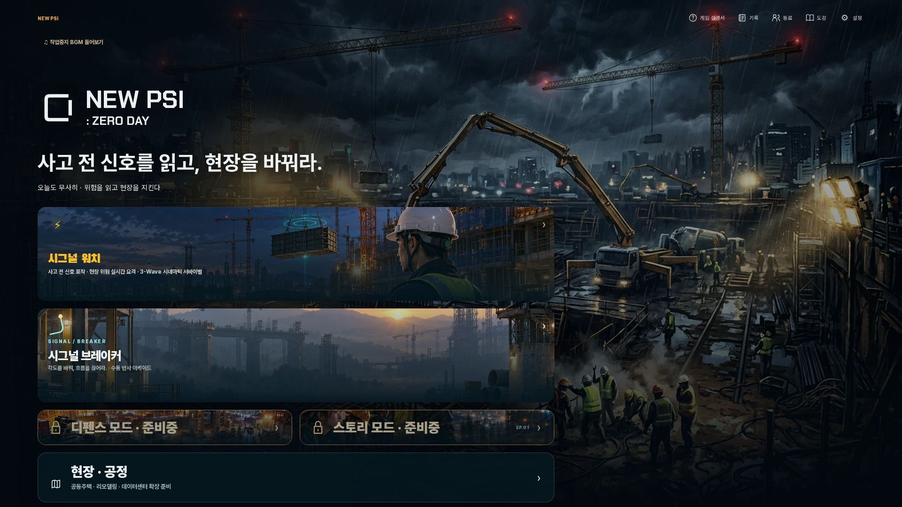
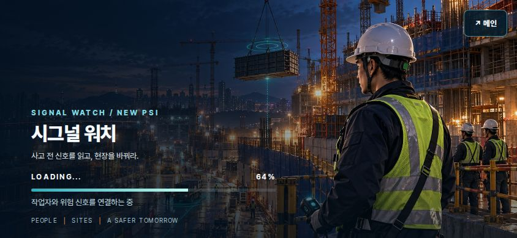
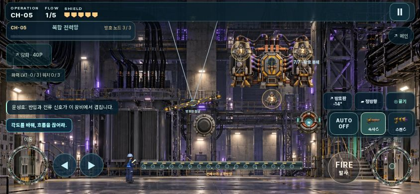
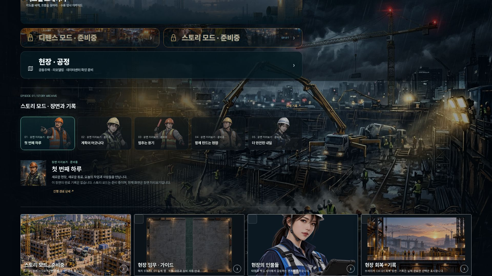

# 시각·진입 보강 검증

메인 → 워치 공통 가로 키아트 로딩 → 수동 출발 준비 → 실제 플레이, 그리고 브레이커 작전 → 독립 본체 → 실제 엔진 약점 타격을 Chromium에서 검증했다. 로컬 데이터·배포 자산을 이용하는 offline-first 흐름이며 외부 API/PSI 프로그램 저장을 완료로 간주하지 않는다.

| 경계 | 결과 | 근거 |
| --- | --- | --- |
| 새 원화 | 통과 | 5개 WebP 폭1024, 실제 alpha·투명 모서리·충분한 본체 픽셀. 각기 독립 소스 |
| 메인 카드·소개 | 통과 | 공통 가로 원화, 실제 STAGE01 맵/CH01 회복 장면, 스토리 준비중 표기 |
| 워치 준비 → 플레이 | 통과 | 1920×1080 / 844×390 / 768×1024 / 390×844. 큰 지도는 구역 탭에만 표시. 수동 출발 버튼 정상 |
| 저장 이어하기 | 통과 | 저장된 stage_02가 같은 실제 맵으로 준비·선택됨 |
| 준비 실패·취소 | 통과 | 워치 원화 요청 실패를 주입한 뒤 재시도 번호를 포함한 새 요청으로 이미지 재생성과 진입 성공. 모듈을 늦게 불러오는 동안 메인 복귀 시 자동 재입장 없음 |
| 브레이커 5종 | 통과 | 5 stage × 4 viewport. 실제 본체 소스 로드·sealed/exposed 각 캡처. 실제 shotBoss()로 노드 해제 |
| 가로 모바일 카메라 | 통과 | 기존 CH05 상단 잘림을 보강. 본체 상단 안전 영역 50px, 노드 화면 포함, 보스 상태 패널과 노드 겹침 없음. 동일 원본 현장의 여유 영역으로 좌우까지 표시 |
| offline | 통과 | 5종 실제 원화가 신규 SW 캐시에 저장된 뒤 네트워크 차단·reload·보스 렌더 성공 |
| 필수 보스 원화 실패 | 통과 | retry 표시 후 재시도로 lobby 정상 진입 |
| 엔딩·수동 다음 작전 | 통과 | CH01 4 viewport + CH02~05 16 stage/viewports. 일시정지·재감상·저장 재로드·보상 중복 방지·다음 작전 수동 선택 |
| 규칙 회귀 | 통과 | 브레이커 Node 193/193. 앱 Vitest 2039 통과, 기존 1 skip. TypeScript 및 production build 성공 |

브라우저 결과 전체는 [results.json](results.json). 보스 상태 주입은 렌더링 경계 검증용 fixture이며 실제 플레이 난이도·사용자 재미 측정으로 부르지 않는다. 원화 교체는 GameState·충돌 판정·보상·저장을 수정하지 않는다.

초기 검증의 기존 preview 포트 충돌 및 순차 컨텍스트 잔존을 제거했다. 최종 검증 스크립트는 전용 포트(5317/strictPort)와 화면별 새 브라우저를 사용하며 production build를 직접 실행하여 네 화면의 전체 흐름을 재검증했다. 이 검증은 Android 실기기 검증을 대신하지 않는다.

## 실제 화면

GitHub CI·운영 배포의 완료 여부는 PR 최종 검사 및 배포 commit으로 추가 확인한다. 이 문서는 로컬 검증을 기록한다. 작업 환경 정리 후 4ed9468 기준으로 복원·통합했고, 193 Node / 2039 앱 검사 및 네 화면 전체 흐름을 다시 통과했다.

최종 production build를 고정한 상태에서도 4 viewport / 20 보스 / 이어하기·취소·재시도 / 실제 offline reload를 다시 통과했다. 최신 모바일 통합에서 상태 문구의 화면 밖 잘림과 강화 버튼·안내 패널의 겹침도 보강했고, 약점과 메시지 패널의 비겹침 및 44px 강화 버튼을 확인했다.
